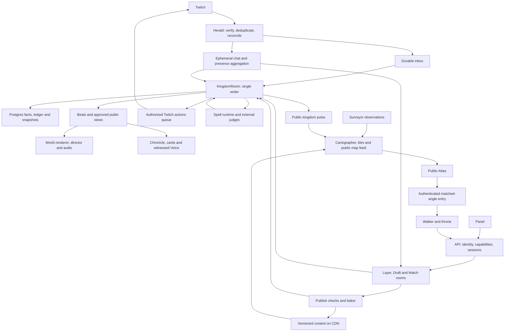

# Chatdom build map

Owner: `chatdom-main` · Written 2026-10-30 · Status: workspace scaffolded; first identity/event and Atlas interchange v1 frozen; Atlas ready for handoff.

This is the map of the whole build, not a release ladder. Dependencies determine what can run together; Tobias
chooses the next work. A small working scene is a proving ground for the full system, never a smaller product.
The source of truth is [ChatDom](../chatdom/ChatDom.md), then each topic's Decided list and latest change log.
[Decisions](DECISIONS.md) records implementation interpretations and unresolved tensions without silently rewriting
the vision. The old prototypes are references, not existing implementation in this repository.

## 1. What we are building

A place, a show, and a world connecting Twitch communities. All three must work through watching, chatting, and
walking. The nine promises in ChatDom §10 are acceptance journeys, not marketing copy:

| Promise | Systems that must meet |
|---|---|
| My light comes on, including when I lurk | Herald/panel presence → private citizen history → light field → stream view |
| My four years here are visible in my street | Identity/follow history → settlement → fixed tenure quarters → home/card |
| My words became a chimney unique to us | Coal ledger → judges → Codex plan → Forge grammar → publish → provenance |
| I built my own house block by block | Voxel engine → private durable draft → publish checks → street revision |
| Twitch moments become a show we join | Event inbox → world facts/crowd windows → spectacle → director/audio → keepsake |
| We sat at the fire with the streamer | Shared room/seats → Dusk Court → private game views → public invited voice |
| We rode out and left a road | Royal action → confirmed Twitch raid → voluntary travel → Atlas → passport/gifts |
| Our tiny kingdom won its league | Earned source ledger → size leagues → participation/beauty/play/visits → crowns |
| My home waited and I was welcomed back | Persistence → absence without loss → returning presence → welcome beat |

These apply to five viewers and fifty thousand. Bodies represent real people; a few clearly distinct keepers run
places. No invented audience. Every visible simulation is labelled **SIMULATED**.

## 2. The connected system

Postgres holds truth. Valkey carries notifications, presence and counters; losing it must not lose ownership,
progress or accepted work. Content is immutable and addressed by hash; publication and visibility are mutable
references. A moderation veil therefore withdraws access to all derivatives, even when their underlying bytes are
immutable. The event log holds game facts, not retained Twitch chat or microphone recordings.

`packages/shared` describes the boundaries; `packages/world` implements the authoritative domain rules. Renderers,
Twitch adapters, Codex and games cannot mint rewards or invent facts. Clients request; the writer validates and
commits; beats make the result visible. The Atlas consumes a public projection and never joins game rooms.

## 3. Contracts to freeze here

The following are contract groups, not files already implemented. Main owns their schemas, examples, compatibility
rules and tests. Freeze each small group when its first consumer starts; do not freeze all groups up front. World/voxel comes next after this first Atlas handoff.
Frozen means versioned and tested, not unchangeable: main owns migrations and updates dependent lane briefs.

| Contract | Lives in | What must be explicit | Unlocks |
|---|---|---|---|
| Identity, authority and privacy | `shared` + rules in `world` | String Twitch IDs; Person/Citizen/Kingdom/Local split; monarch/mod/Warden capabilities; trust separate from money; three-home cap and castle exception; anonymous light versus named identity; passport/home disclosure; consent and revocation | Every client, API, Herald, safety |
| Intent, fact, beat and time | `shared` + `world` | Idempotency/cause IDs; schema version; writer epoch and sequence; occurred/received/applied time; recovered/live/simulated origin; seeded RNG; durable timers; public/private projections; four beat levels; acknowledgements and retry semantics | Realm, Herald, director, Chronicle, tests |
| Presence and crowd participation | `shared` + `world` | One minute tick; chat/panel/walker dedupe; idle/stream-night rules; unnamed lurker accrual; one person/one vote across transports and layers; window deadlines, stream delay and ad pauses; moderation removals | Herald, panel, games, lights, progression |
| Ledger, ownership and provenance | `shared` + `world` | Source classes; money cannot mint standing; coal earn/reserve/consume/refund, cap 3, home eligibility and castle exception; equal event caps; item versus copy; portable versus kingdom-bound possessions; consented gifts/swaps; append-only story with identity redaction | Forge, content, play, seasons, travel |
| Atlas boundary — first independent freeze | `shared` | Edition/holding IDs; frozen geometry; pencil/ink/colour; tiles and versioned asset manifest; `live.bin` v2, dabs and map events; freshness/coverage; public pulse; privacy bands; card/search DTOs; hero drawing/entry descriptor; map links and travel IDs | Atlas immediately, kingdom integration independently |
| Twitch ingress and outbound actions | `shared` | Normalized event families; durable inbox versus transient text; transaction/event dedupe; reconciliation gaps; action request/result/unknown outcome; actor/consent/token scope; royal preview/confirmation; dev write allowlist; Extension identity and Bits receipt | Herald, API auth adapters, panel |
| Voxel, content and interaction | `shared`; algorithms in `voxel` | Units/lattices; chunk/CVOX format; material/style IDs; immutable asset manifest; structure versus pieces; carves/sockets/doors; occupancy/picking; interactions and animation/sound requirements; bounds/budgets; worker revisions | Content, baker, world builder, Forge |
| Draft and publication | `shared` + `world`/`voxel` | Ordered edit ops, ownership, acknowledgement and undo; IndexedDB pending ops; plot revision; support/egress checks; returning-citizen permission; approval states; last-approved fallback; atomic publish; invalidation of bakes | Build mode, DraftRoom, baker, Watch |
| Appearance and animation | `shared` + `anim` | Shared skeleton/part sockets; chibi proportion; face states; clip/action timing; stance and springs; appearance hash; person look versus local earned pieces; LODs; equal-brightness sub tint | Wardrobe, avatar content, crowds, voice |
| Making and judgment | `shared` | Pass/soften/hold/refuse; input/result checks outside agent; verdict/model/question-set versions; approved asset lineage; stream pass distinct from world publish; appeal/veil/revert; derivative invalidation; private refusal versus nameless beat | Forge, Genesis, games, build publishing, Watch |
| Realm/session/travel protocol | `shared` + authority in `world` | Room roles, seat leases/reconnects, layer membership, movement validation, rate/bandwidth caps, writer failover, cross-kingdom reservation and rollback, no forced travel, destination bans | Realtime clients, games, Raid Gate |
| Games and voice | `shared`; semantics in `chalk` | Family/variant manifest, view classes, legal-move visibility, match commands/results, practice rewards, deadlines, spectator/stream views, miniature summary; invited seats, age/consent, LiveKit permission lifecycle | Tavern games, Taster, campfire, Royal Audience |
| Spells and founding | `shared` | HousePartPlan, Charter, family/Chalk plans, fact-cited Voice lines; deterministic tools; quotas/timeouts; two external gates; checked fallback; ritual progress as observations of work, never fake success | Codex runtime, Forge, Genesis, Voice |
| Seasons, discovery and memory | `shared` + `world` | Common league brackets, versioned score sources, contribution caps, visitor garlands, crowns, wonder progress; Chronicle/card/still records with fact and asset dependencies; privacy and retraction | Seasons, Chronicle, Atlas rankings, share surfaces |

Every contract freeze includes representative and hostile fixtures, visibility rules, failure/retry behavior,
budget limits, and a consumer example. No giant event union guessed from missing `docs/` files: derive the catalogue
from the current vision and preserve an explicit coverage table against Twitch §3 and World-Tree's seven branches.
No `Math.random`, wall-clock reads or render dependencies in deterministic packages.

## 4. What stays in this thread

Main owns integration and the systems whose feel and authority determine everything built on them. Astra at xhigh
is used for their architecture/core work, Sol at high for integration, Terra for disjoint visual/test work, and Luna
for recon. Sub-agents inside this checkout never run git. Lanes remain separate workers in separate worktrees.

### World truth and realtime

Build the pure reducer, seeded simulation, ledger, durable scheduler, identity and settlement rules, provenance,
world lifecycle, and beats. Build the Postgres writer fencing/inbox/outbox/recovery foundation and the four room
adapters: KingdomRoom, LayerRoom, MatchRoom and DraftRoom. Private data never enters broadcast schemas.

Layers hold about 300 walkers, with a hard cap of 400 as the starting budget. Nearest-avatar interest views, royal
layer first-come admission, friends following, mirrored ceremonial seats, crowd summaries and reconnects must all
work without paid priority. Chatters are data, not one websocket each. Sleeping kingdoms cost no resident room;
their durable inbox survives. Live broadcasts wake the kingdom; reruns do not earn presence.

### Voxel world, lighting, avatars and build mode

Build the actual walkable kingdom: terrain and horizons, roads/tenure quarters, full reserved lots, structures and
placed pieces, enterable interiors, navigation, picking and shared solid occupancy. Terrain uses 0.5 m, building
and Forge parts 0.125 m, avatars/pets 0.0625 m. Lots reserve 8 × 16 × 20 m; growth moves the back fence, never a
neighbour. Ward expansion preserves old streets and addresses, including late-arriving long-time followers.

The mesher, baked AO, chunk workers, packed materials, LODs, light field, warm windows, fog, water, sky, weather and
painterly interiors must deliver the crafted toy kingdom at dusk. The light field is real scope, not optional
polish. Study external implementations before freezing these designs. Validate the rendering path in WebGL2/OBS
before prescribing a shader API; do not assume a library promise is working code.

Own the free-cursor controls, collision-safe follow/orbit/dollhouse cameras, touch and gamepad, action picking and
local response. Own the chibi body/face builder, shared rig, layered distance-driven pose evaluator, capes/hair,
wardrobe composition and crowd renderer. All avatars are people, with individual timing, not synchronised dolls.
The tier-3 cape shimmers in palette colour, never extra glow. Content batches follow these contracts in lanes.

Own free voxel editing: brush sizes available immediately, place/shape/extrude/paint/erase/fill, pieces, select,
mirror/copy/blueprints, eyedropper, `.vox` import, private drafts, durable undo and publish. Authored detail adds
eaves/trim/sills without rewriting the citizen's structure. Forge doors/windows carve reversible openings.
Every usable-looking asset works. Every build has support and an escape path; publication never traps people.

### Forge grammar, Genesis and game-language authority

Main freezes and proves the fixed-shape Forge grammar, deterministic assembler and beauty checks, the Charter/layout
generator, and Chalk's total interpreter/view semantics and Taster verification core. These are core rules, not
handed to a UI lane to improvise. Taster includes whole-family settings checks, fairness/termination and two-world
trace/taint checks, including legal moves and phase conditions that could disclose private state.
Implementation of the spell service, content library and games can then proceed independently.

The full Forge scope includes the decided worn-piece branch on avatar sockets. Main owns its grammar/contract;
content and safety lanes own its authored pieces and dedicated golden set. House parts open first under the
founder's rule; worn pieces activate only when their own shapes and checks pass. Creatures never enter the Forge.
The spell contract must represent branch-specific plans without weakening the house-part schema.

Genesis reads the channel, gives checked name choices to chat, ranks landscapes, and creates its style, quarters,
landmarks, emote monuments and hero angles. The ceremony is live only, about 3–4 minutes including the 15-second
rise; at most two live redraws and a safe deterministic fallback at four minutes. Preparation is data gathering,
not a private founding. Once raised, the land stays put.

## 5. Whole-product work and lane boundaries

The paths below are proposed exclusive write scopes, to be created as needed. Shared files, package manifests,
root configuration, route registration and cross-lane composition stay with main unless a spec explicitly assigns
them. Multiple paths in a row form one bounded responsibility, not permission to edit their parent folders.
Split broad responsibilities into small PRDs (normally 3–6 tasks) as their contracts freeze.

| Lane / owner | Proposed scope | Complete responsibility | Needs |
|---|---|---|---|
| **Atlas — first handoff** | `apps/web/src/atlas/**`, `apps/surveyor/**` | Surveyor adapter; Cartographer; editions, language continents/game-family realms, fixed holdings and hamlet slots; tile baking and overlays; wash/pennants/dabs; roads/caravans/raid trains/bridges/trade routes; search, cards, public links, My Twitch, passport/friend privacy; crowns, Kingdom of the Week, map history; entry drawing/return/Raid Gate UI | Atlas boundary + shared identity/public view; no voxel runtime dependency |
| **Herald** | `apps/herald/**`, `packages/twitch/**` | Typed Helix/EventSub client, tiered grants adapter, conduit ingest, ephemeral chat, presence, reconciliation, token refresh/validation, outbound queue/budgets, confirmed actions, Extension transaction reconciliation | Identity/event/presence/action contracts; API token-store interface |
| **Panel** | `apps/panel/**`, `apps/api/src/panel/**` | Twitch Extension desktop/mobile/config/live config, identity sharing and light tap, home card, night painting, crowd acts, communal pool, tonight's moments, Bits shelf, PubSub, EBS verification and review package | Identity/presence/actions/receipts; panel DTOs; carved tokens; CDN stills |
| **API account surfaces** | `apps/api/src/accounts/**`, `apps/web/src/account/**` | OIDC/session claiming, consent UI, grants integration, quiet/forget/privacy, home choices, rename/revoke/delete/recovery and public-safe account projections | Main's auth/storage/capability contracts; no replacement world authority |
| **Carved UI** | `packages/ui/**` | Wood/brass/parchment/wax kit, type, drawn icon family, focus and input behavior, physical motion, responsive states and component gallery | Design tokens, action/sound hooks, interface inventory |
| **Content library** | Separate assigned subfolders of `packages/content/**` | Kingdom style kits, biomes, starter homes, civic places, furniture/tools, plants/wild species, companions, great beasts/dragon, wardrobe/tenure/sub pieces, curated flags, Forge motifs, emote uses, clips and seasonal decorations | Asset/interaction/rig/Forge contracts; visual benches |
| **Baker** | `apps/baker/**` | CVOX versions, plot/ward LODs and impostors, contact sheets, guarded publication, emote conversion, approved Atlas drawings from real geometry, derivatives and CDN invalidation | Voxel/assets/publication/judgment; main's render API |
| **Spell runtime and Watch** | `apps/codex/**`, `apps/api/src/watch/**`, `apps/web/src/watch/**` | API-key Codex workers/tools, bounded spell recipes, warm latency/cost tests, two independent gates, golden sets/drift checks, holds/appeals/rechecks, global veil and stream-pass workflows | Spell/grammar/judgment/authority contracts; approved renderer/assembler tools |
| **Games and tavern** | `packages/chalk/src/families/**`, `apps/taster/**`, `apps/web/src/games/**`, `apps/realm/src/matches/families/**` | Authored verified families; quiz/chalk/chess/dice/regatta and Dusk Court; four chat modes (one player/many/teams/seats); Tableware styles and miniatures; spectate/join/resume; prompt variants, promise checks, shelf, crown polish and travelling author credit; full new-rules path behind its evidence gate | Main's Chalk/Trestle/view/seat/result contracts; art library and Taster core |
| **Voice** | `apps/api/src/voice/**`, `apps/realm/src/voice/**`, `apps/web/src/voice/**` | Campfire and Royal Audience invitation, 16+ consent, trust/seat verification, PTT, permission revocation, OBS listening/monitoring and limiter; text seats; no recording | Seats/moderation/capability protocol; LiveKit adapter |
| **Throne** | `apps/web/src/throne/**`, `apps/api/src/throne/**` | Connect and live-founding controls; dock/tab/phone/Stream Deck; one-press royal acts with previews, suggestions capped at three, Busy, safe areas, stream pass, safety keys, cost display and lifecycle | Capabilities/confirmed action results/Genesis/director interfaces |
| **Director and stream** | `apps/web/src/stream/**`, `apps/web/src/director/**` | Beat-driven shot grammar, occlusion checks, calm/show, stage/corner/strip and seams, shutters, preloads, live Genesis direction, selected auto-open with veto, missed-climax in-app replay, OBS loss/recovery and long soak | Main's camera/render/beat/public projection; replay contract |
| **Audio** | `packages/audio/**`, assigned `packages/content/audio/**` | Material/interaction variation banks, spatial sources, presence-layered music, per-device decoding/unlock, limiter and distinct broadcast mix; playback of checked Voice lines | Action/clip/beat clocks; content/licensing decision |
| **Social life, wilds and progression** | `apps/realm/src/features/life/**`, `apps/web/src/life/**` | Friendship/consented paired acts, giving/tending, cross-kingdom swaps, companions and bonds, wild exploration/gathering, great beast, tools/toys, seasonal species, streaks/return welcomes, street and wonder contributions | Main's reducer/ledger/ownership/consent contracts; contributions request core facts |
| **Spectacles** | `apps/web/src/spectacles/**`, assigned `packages/content/spectacles/**` | Forge/housewarming/emote unveilings, gift parcels, emote weather, cheers/Power-ups/charity, Hype Train, earned dragon and free Wyrm Bell, raid arrivals, festivals and crowning; cause-to-peak-to-trace choreography | World facts/beat timing; content/animation/audio; paid/free cap rules |
| **Seasons and discovery** | `apps/realm/src/features/seasons/**`, `apps/web/src/seasons/**` | Shared size brackets, median-home beauty, breadth of participation, wonders, visitors/garlands, games/rating, opt-in contests/tournaments/build-offs, festivals/Long Night/Founding Day, citations/crowns and Kingdom of the Week | Ledger/source exclusions, season rules, Atlas projections |
| **Chronicle and cards** | `apps/api/src/memory/**`, `apps/web/src/memory/**` | Citizen cards/all eligible homes/passport, house plaques and guestbook, item lineage, Almanac/honours, nightly Ballad and stills, personal night cards/share images, Gallery of director stills and viewer clip links, weekly letters | Fact-cited memory, privacy, asset retraction and Voice contracts |
| **Studio** | `apps/studio/**` | Opted-in wire capture and retention, same-decoder replay, frame barriers, offline render/editor and labelled rehearsals; internal tooling only | Network versions, asset manifest, redaction, no-secret recording view |
| **Quality and operations** | Assigned `packages/testing/**` suites and `work/reviews/**`; operational tooling scoped separately | Collision/input/recovery/visual/beauty/privacy/load tests, device tour, backups/restore drills, metrics, runbooks, dependency/license inventory, rolling recovery and cost alarms | Contracts and runnable surfaces; deployment authority remains with main/team |

One lane never edits another lane's files. Feature lanes submit intents/results to the main-owned world package;
they cannot quietly grow alternate ledgers or reducers. Backend extensions import main-owned services through
explicit ports. Main registers them and reviews the integrated behavior before merging.

## 6. Breadth that must not fall through the seams

**Twitch coverage.** Preserve a test row for every Twitch §3 family: presence/chat/panel; follows/streaks;
subs/resubs/lapses/gifts; cheers/Power-ups/panel Bits/charity; live/offline/category/title/schedule; trains/goals/ads;
rewards/pool/polls/predictions/commands; raids/trains/shared chat/shoutouts; emotes/badges/mods/VIPs; deletes,
timeouts/bans/announcements/Shield. Missing authorization or API capability has an honest fallback. Recovered
events repair state without pretending the spectacle happened live. Twitch writes use the action service, even
when another doc describes the API as the caller. Paid actions are deduped and reconciled, never guessed successful.

**World depth.** Homes are personal; the streets are communal within their style; the monarch owns castle/plaza
design; everyone can contribute to wonders. Gifts are free, swaps require consent and happen only across kingdoms;
there is no trade currency or personal damage. Companions wait, bond by days, and neither die nor become purchases.
Wilds, native materials, weather, moon/hour habitats, shared great beasts, toys and tools give ordinary nights life.
Games occupy the tavern, campfire, arena, plaza and theatre as appropriate, rather than a detached menu.

**Safety and privacy.** Input and composed result checks cover all made things, including builds, names, signs,
notes, games, emote statues, drawings and spoken lines. Neither the creator agent nor an unchecked render can
approve itself. Failing checks keep the last safe version visible. Wardens decide holds only; Watch/mods retain
their own powers; royal acts remain monarch-only. A veil reaches copies, gifts, impostors, drawings, share cards,
Chronicles and replays. Report/appeal tooling, block/mute/harassment rules, age handling and data erasure need
their own complete contracts: Safety §7 lists unfinished design, not permission to omit it. Never show private
ballots, dice, voices or refusals in a stream client or recorder. Twitch moderation removes access/voice promptly;
it never destroys a home or brands someone forever.

**Money and earned history.** Coals come only from presence, one once 10 minutes qualify a stream night, capped
at three; roars open anvils only. Trust does not change vote weight or coal cap.
Subs add pieces, edge tint and one-time street influence within the follow-year quarter; lapses dim, never delete.
Bits give everyone a moment or a day-long effect, with no permanent buyer advantage. Equal keepsakes for a shared
moment are allowed. Pool contributions are communal, with breadth constraints; scoring must not turn a paid or
points-funded shortcut into bought glory. The exact pool-to-wonder/score relationship requires a core decision.

**Public discovery.** Day-map paint and pennants, fixed geography by edition, no people search or public follower
graph. Shared-citizen/settler figures start at 20 and use bands, with the specified opt-outs. Other homes are shown
only after first sign-in; passport is public with a hide switch. Private follows are used for My Twitch, not stored.
Settlers before kings, small live dabs and land by raid from Edition I are part of the map's actual data model.

**Failure and lifecycle.** Offline kingdoms remain visitable; absence never folds homes. Voluntarily leaving a home
to settle a fourth folds it whole and preserves its address; kingdom deletion preserves owners' homes as keepsakes.
Rename, revoke, disconnect, exhausted spell capacity, late Twitch events, lost seats, failed publication and a
crashed writer each need a designed outcome. Safe fallback Genesis and a cold Forge do not fake a successful spell.

**The realm's voice.** The spell-runtime lane owns checked, fact-cited text → speech through the provider adapter
specified in Tech (ElevenLabs), plus versioned audio caching and withdrawal. The audio lane plays that asset on the
shared cue; Chronicle keeps the approved words and stills. Streamer veto and safety checks precede publication.
No participant microphone recording is needed for this pipeline.

## 7. Parallel work from the start

This turn writes the map only. Next turn scaffolds. No lane is launched against imaginary contracts today.

1. **Main establishes the workspace and the first boundaries.** TypeScript/pnpm/Vite/Vitest/Playwright, schema
   checks and verification entry point; identity/event envelope and the narrow Atlas public contract first.
   Create actual files only for current work. Verify the documented package/runtime pins before adopting them.
2. **Atlas goes to the team first.** Freeze its contract and write its spec and Ralph PRD in that same turn. Its
   worker can build real cartography, tiles, data ingestion and public UI from Surveyor observations while main
   builds the world. An approved stamp is a valid pre-drawing state; do not fake a founded voxel kingdom.
3. **Research can run beside that immediately.** Independent agents study reference meshing/lighting, water/sky,
   animation/crowds, map interaction and networking; write source/license/technique notes before implementation
   specs freeze. Review the actual demos/frames as well as the algorithms. Prototype findings are indexed in
   [references/prototypes.md](references/prototypes.md).
4. **Herald and panel open together when their contracts exist.** Main freezes presence, capabilities, events,
   actions, Extension receipts and the API boundary; their specs go out in that turn. Herald uses recorded/CLI
   inputs and authorized live reads; panel uses validated DTOs, with simulations visibly labelled. Neither waits
   for a finished town. The real integration must then prove that one panel tap lights the same citizen once.
5. **Content, UI, audio and bake work fan out when their formats exist.** Main establishes scale/palette/rig,
   interactions and tools; artisans build and inspect disjoint batches while main stays on voxels, avatars and
   editing. UI tokens can serve Atlas/panel before the world is complete. Sound authorship is an open decision,
   not grounds to ship silent actions.
6. **Games, throne, runtime magic, Chronicle and other lanes follow their own dependency edges.** A frozen Chalk
   view/result boundary opens families/Taster; seat/capability boundaries open voice; fact/public-view boundaries
   open Chronicle and stream presentation. No need to wait for every upstream visual to be finished.

Each lane gets `work/specs/<nn>-<slug>.md`, `work/lanes/<name>/PRD.md`, `progress.txt`, a branch `lane/<name>` and
its own worktree. Main commits the contract/spec first; the team starts the worker. Once handed off, main reviews
and integrates rather than rebuilding the lane. A worker writes `needs:` for contract changes and takes another
unblocked task. Main resolves it and updates the contract; lanes do not patch `packages/shared` themselves.

## 8. How we prove it is real

`pnpm verify` will run typecheck, lint, tests, build and standard screenshots once scaffolded. Checks grow with the
surfaces, and must assert real outcomes. This planning commit has no executable app and cannot claim a green
product build. No empty tests or placeholder UI used as evidence.

| Evidence | What it must demonstrate |
|---|---|
| World/authority | Duplicate and reordered input cannot double-reward; simultaneous writers cannot commit; crash/replay has the same state; no money-to-standing path; private fields absent from public views |
| Solid world and input | Walk/camera through every door, wall and prop; soft-push without trapping; footsteps grounded; tools leave movement working; response under 100 ms; camera returns after every cinematic |
| Building and making | Disconnect/tab/server kills during edits, forge, publish and games preserve accepted work; last approved build remains visible during holds; edits acknowledge and reconcile; no unsafe intermediate asset escapes |
| Presentation | Noon/dusk/night fixed-camera views, close/medium/far crowds, shared painted interiors, animation/action/sound coverage, Forge/Genesis beauty batches, all empty/loading/error/offline states |
| Scale | Five-viewer hamlet and 50,000-viewer capital; walkers distinguished from chatters; 200-bot change-set and 1,000-bot milestone checks, plus larger capacity evidence; map traffic never becomes room traffic |
| Real Twitch | Duplicate webhook, reconnect gaps, revocation, rate exhaustion, API refusal, Bits reconciliation, panel identity and moderation; outbound tests only on `tobi4s_` |
| Operations | Backup restored, writer killed and recovered, safe rolling reconnect, published asset retracted everywhere, stream token rotated, OBS context loss/reload/hidden state and six-hour soak |

Look at screenshots with `view_image`: web 1440×900 and 390×844, stream 1920×1080, panel 318×496; also inspect the
corner/strip/dock and mobile Extension at their actual sizes. A screenshot is not an animation or audio review.
Run the same hand-played tour on gaming PC, everyday laptop, phone and OBS. SwiftShader proves deterministic
rendering and behavior here, not real-GPU frame time.

Targets from Quality/Tech remain targets until measured: laptop 60 fps, phone at least 30, OBS 1080p60 at roughly
4 ms GPU cost; no normal frame above twice target time. Keep scene/bundle/memory budgets executable. Preserve
charm on lower tiers: presence light, clay materials, animation, sound and crafted UI. Node 24 in Tech versus the
available Node 22, shader compatibility and contradictory loading estimates must be checked during scaffolding.

Operations are part of the build: Postgres backup/PITR and migrations, Valkey outage recovery, conduit canaries,
inbox/patch/spell latency metrics, error seals, cost alarms, retention/erasure and license inventories. Planned
hosting remains US East with R2/CDN and LiveKit. This map authorizes no deployment or server configuration.
Request infrastructure from the team when a concrete test needs it; do not substitute an in-memory success path.

## 9. Open decisions and doubts

| Question / tension | Owner and next evidence |
|---|---|
| Presence light — decided 2026-10-30 | Citizen’s own warm window, named up close; castle beacon is the kingdom’s light. Prove the dusk scene next. |
| Sound — decided; hero animation still open | CC0/permissive libraries plus procedural sound; every source in THIRD_PARTY.md; no silent actions. Hero animation still needs its bench. |
| Per-kingdom runtime AI budget | Main + Tobias; warm Forge/Genesis/variant calls measured for latency, tokens and daily load; free kingdoms need fair capacity/degradation without selling coals |
| Renderer/pins and real-device floor | Main; confirm WebGL2/OBS material path, installed versions and phone/Firefox/macOS OBS targets; current host is not the GPU mentioned in old measurements |
| Pool contribution versus earned score | Main domain spec; settle ledger treatment, contribution breadth/caps and one league bracket table before seasons or pool rewards can ship |
| General generated games | Main/Taster; implement the full bounded new-rules path, but preserve the founder's activation gate: at least 60 of 100 real prompts pass all checks; verified variants still fulfil table requests |
| Voice/harassment/age/cross-kingdom moderation | Main safety spec and founder choices; Safety §7 is unfinished; explicitly design block/mute, consent, ban reach, appeals and failure policy before exposure |
| Twitch data to AI and retention | Team obtains the written/legal answers already requested by the vision; design provider/data boundaries and deletion independently; never infer consent from a code path |
| Day-long panel Bits outside Twitch | Twitch written answer; preserve configurable expiry/eligibility and exact receipts; no promise of approval or monetization eligibility yet |
| Atlas Edition I and observation coverage | Tobias decides edition founding; Atlas lane verifies actual Surveyor coverage/freshness, content labels and cap limitations; document counts/dates are not current evidence |
| Raid receiving policy, game adoption and recording retention | Resolve the remaining Tech §19 choices before those actions activate; author credit always travels; no auto-recording merely because Studio exists |
| Durable history and avatar collision conflicts | Implementation decisions in DECISIONS: acknowledge only durable accepted work; no slide-through escape; prove bounded avoidance/egress and recovery rather than relaxing Quality |
| Accessibility/photosensitivity | Quality §6 did not adopt a blanket rule; recommend a focused decision before fireworks/voice/UI freeze, while preserving its existing keyboard/touch/focus requirements |

The missing `docs/` research and old prototype timings are not dependencies to resurrect. Re-study the relevant
techniques in available source and current primary documentation at each freeze. Some apparent questions are
already settled: no royal coals, no subscriber vote weight, no night Atlas, no public video creation, no paid map
position, no creature Forge, no real crowd without real people. Do not reopen them by accident.

## 10. Current handoff state — 2026-10-30

**Active: rebuild the settlement composition.** Founder GPU review accepts light, hills, lake and beacon;
rejects the repeated suburb rows and undersized castle. Build genuinely winding land-following streets,
a market at their meeting, and a larger castle above the town. Finish the one-window/name → town ripple →
beacon moment. Walking avatars and build mode remain the next brief. No final art acceptance or wave film yet.

### Pushed and demonstrated

- Latest main includes `565c8db` four-turn content placement, `3a080db` compound beacon proof, `0a0da9c` individual distant-window audit and `335a2c5` all-tier, all-turn Hearth light tests and `7602378` presence consumer preparation, after `ad16d78` checkpoint and `ba345e4` three-field budget proof, after `fb6aed6` worker-domain handoff and `370ba78` inhabited light bounds, after `adf27ab` castle/cardinal consumers, `de0c5db` shoreline correction, `c17e0d5` rendered live readiness, `a088e76` complete content integration, `7d7a9cc` capture queue, `818244b` street-camera/terrain culling, `2d8b55b` natural ground and recessed-window projection. Every milestone is pushed; history is never rewritten.
- Small identity/event, Atlas, world/voxel and presence contracts are frozen with fixtures. Herald spec03 and content specs04–06/PRDs/worktrees exist. Presence is the citizen's own warm window, one person/one designated pane, named nearby; beacon is the kingdom's light. SIMULATED labels remain visible. The strict public SSE adapter accepts its configured live or simulated origin with freshness/epoch/sequence guards.
- Existing engine: worker meshing with AO/sky, grounded rolling terrain, 24-home hamlet/240-home town, immutable full tenure reservations, reviewed Hearth tiers and passive street props, reversible LOD/pane fades, actual near/far/beacon occluded light, cached directional shadows, groves, terrain-clipped water, sky/fog/time and credited procedural sound. The current production layout still has the rejected parallel rows.
- Last full integrated `pnpm verify`: 858 tests in44 files, typecheck/lint/build and19 standard shots (12kingdom,6stream,panel). Main viewed all current matrices in `work/evidence/content-final/`; lane assets validated15Hearth/20props. Subsequent shoreline step passed864 tests including6new castle-module tests, source checks/build and two serial dusk captures; it does not certify the new town.
- `c17e0d5`: no-time opening shows240 SIMULATED residents and advertises ready only after a rendered frame with all3 light uploads. Explicit replay resets0 →1, actual propagated light, Juniper visible. Browser/worker errors empty. Proof: `work/evidence/kingdom/live-ready/report.json`. Never require a continuously live queue to become idle before ready.
- `de0c5db`: subdued bank/shallow bed and depth-faded reflection remove the bright lake outline. Main viewed1440×900 A/B plus390×844. Evidence: `work/evidence/kingdom/shoreline/`. Open-water reflection and accepted dusk light remain.
- Runtime proof in `work/reviews/kingdom-runtime.md` / committed evidence covers actual context loss, worker construction/runtime failures, stale/live/offline/disconnected Herald frames, source withdrawal and cached shadow updates. No real Twitch chat ingest success or real-GPU timing is claimed. CPU camera-clearance proof is in `work/evidence/content-final/camera-sweep.json`; regenerate after changing geography/camera.

### Current work and next integration

- Proposed consumer contract: `work/specs/02b-settlement-plan.md`; pinned read-only architecture study: `work/references/settlement-streets.md`. Main accepted direction, not an untested typed freeze. Astra xhigh owns the uncommitted settlement generator, routing and terrain files plus their fixtures. Legacy running layout stays until the new plan is tested and main migrates consumers.
- New plan: immutable founding geography independent of population/year; canonical48 reserved sites per quarter before activation; actual connected roads/courts/frontage approaches/market; all4 cardinal home turns; exact helper transforms; local grading; revision included in terrain cache identity. No jittered row substitution or global refit that moves existing homes.
- Cardinal transforms and the small castle placement group are tested for their first consumers. Castle module dimensions are pinned: existing32×31×32m keep;12×24×12 towers;16×18×10 open gatehouse;12/20/24×10×3 curtains. Compound64×48m, foundation20m, market~9m, actual keep beacon50.5m. Terra high authored `packages/content/src/core/castle-modules.ts`;9 tests cover schema/palette/dimensions, all occupied components grounded,4×6m gate, shallow keep steps,8 actual tower/wall joins and the full outer-gate→court route. Main's3 castle placement tests resolve the actual compound and beacon; shared transforms have2 all-turn tests. A new `content:render --collection core --scene castle` bench consumes the same constructor/placement helper as the kingdom will. Main viewed all6 front/side/back desktop/phone renders, plus full desktop front; measured100,250 full-detail triangles/12 bench draws. Evidence: `work/evidence/kingdom/castle-compound/`. Focused24 tests, typecheck, source lint and build pass; the prior broad run passed871 tests with only the uncommitted generator probe excluded. This freezes the small placement/castle group, not the new settlement generator or its final silhouette in terrain.
- Main rejected the first generated layout after inspecting its actual overhead plot: six-house star courts repeated as suburban pods. Astra replaced that with roads first and individual street-facing reservations, with occasional small greens. An initial road-first town returned but spread444×396m. An attempt to compact it exposed trapped future-quarter routes; the architect is reserving a permanent civic spine and connected quarter networks before fitting frontage lots. Both layouts must succeed and fit the light domain before acceptance. The street-plan generator remains unaccepted and uncommitted. Main has not switched the running scene.
- Main owns migration of settlement content/props, terrain worker/material/cache, scene/castle/beacon/shadows/groves/cameras, presence scenario, field domain/coverage and camera harness. `inhabitedLightBounds` now computes the full active reservations plus16m spill and the light worker accepts explicit bounds; the old scene retains its prior domain until migration. A real 240-home regression proves expanded decorative terrain no longer forces 4m cells when this domain is supplied. Individual new-layout emitters and the combined three-field budget remain unverified. Use one placed castle module list for geometry, occlusion, shadows and actual beacon anchor. Retain .125m build scale; no visual-only castle scaling.
- Astra high review found terrain bounds416×432m force the old far field to4m and suppress66/240 isolated emitters. Derive the new light domain from active full reservations plus spill instead of decorative lake/collar terrain. Prove each designated frontage independently, then all240 together, and include near+far+beacon under12MiB. Do not borrow neighbour light or relax budgets. Mandatory ground overlaps must agree; graph reachability alone is insufficient without full1.5m rendered entrance corridors/grades.
- Next: finish/review additive contract fixtures, freeze that small group, migrate consumers, inspect winding-town dusk before broad captures. Then updated noon/dusk/night desktop/phone plus standard surfaces, actual camera clearance, short wave capture and final green verify/commit/push. Scene remains the active goal until the moment and full evidence land.

### Team and host

- `lane/street-props`: SP03 `ab8cea5`, merged `583c30b`; accepted complete. `lane/homes-hearth`: HH03 `ea77d88`, HH04 `50a2f34`, merged `d7b31a3`; accepted complete. Both worktrees fast-forwarded to `a088e76` with frozen installs. Main selects all5 Hearth tiers; stable address/window tests pass. Review: `work/reviews/2026-10-30-content-final.md`.
- `lane/atlas`: A01/A02 `0a3ba03` merged `082232a`; Surveyor lockfile unblock is done, lane may continue. Atlas team owns later work. `lane/herald`: H01 merged; real/simulated adapter seam fixed in `7b8e2eb` and its PRD. H02/H03 and Tide work remain team-owned; inspect worktree status before any next merge, never copy unfinished files.
- Capture scripts acquire the same machine-wide flock before preview/Chrome, including external-base-url paths.6subprocess tests and an actual two-worktree queued-runner probe passed: `work/evidence/content-final/capture-queue.json`. Finished Hearth/street worktrees have the helper. Other/old worktrees need `7d7a9cc` or newer; already-running old scripts cannot lock retroactively.
- Keep captures lean, serial and CPU-bounded on the shared host (`taskset -c 0,1 nice -n15`). Vitest maxWorkers2. SwiftShader produces behavior/pixels, never meaningful FPS. Default `pnpm verify` retains19shots; targeted filters allow only needed views during look iterations.
- Owned preview5190 serves built readiness/shoreline changes (`/?tier=town&hour=19.5`), not future streets. Recheck it before reporting availability. Capture previews allocate free ports; env can pin them. Team-reserved Atlas5193, Herald5194, optional callback5195; existing Postgres/Valkey/Surveyor belong to the host/team and remain untouched. Do not kill unrelated processes.
- Secrets stay ignored. New committed paths are repo-relative. Historical checkpoints (including superseded pauses, counts and preview sessions) are preserved in [the checkpoint archive](history/kingdom-checkpoints-2026-10-30.md), not current instructions.

- Latest milestone `370ba78` passed45 light-field tests and scoped lint. Typecheck of the committed source passed with the architect’s uncommitted generator files excluded; global typecheck passed with those files present on the subsequent check. Full `pnpm verify` remains required after generator integration.

- `ba345e4` adds the beacon field to the existing actual current-town near/far workspace test; all three together remain under12MiB. `fb6aed6` verifies the explicit domain survives the worker handoff and produces an accepted volume. These are current-layout proofs only; repeat them with the new castle and settlement after integration.

- `7602378` allows the existing labelled SIMULATED presence producer to consume the new settlement home shape; its15 existing tests and current-worktree typecheck pass. This is an adapter preparation only: no new layout or real chat is active in the scene.

- The current town now has an isolated-source proof for every one of its240 designated windows at the inhabited two-metre field resolution, including the current castle as an occluder. Each source independently visits light cells; neighbours cannot mask a suppressed source. All five Hearth tiers, three families and four cardinal turns also pass near-field light/removal. The future settlement and compound still require this proof with their own geometry.

- The actual twelve-module castle and authored beacon anchor now pass an occluded beacon solve and the combined near/far/beacon12MiB guard alongside the existing town, with removal and occupancy reuse. The conservative cap cell projects the emitter into real air above it. This uses the old town terrain: repeat against the new settlement before acceptance. All88 field tests and current-worktree typecheck pass.

- `565c8db` extracts `placeSettlementContent(plots, ground)` for the new plan consumer. Actual facade and prop grounding pass at all four turns; the current scene still uses its old ground sampler. Latest broad run passed921 tests excluding only the unfinished generator probe. Global lint currently reports two unused variables in the in-progress generator; the architect has been notified. Full `pnpm verify`, final screenshots and wave film remain outstanding.

- Entrance audit found a garden shrub overlapping the 1.5m direct approach for off-centre Hearth doors. Prop placement now leaves the full authored Hearth/Tide door corridor clear across five tiers, three variants and four turns; current-town reservation and field tests pass. Main looked at serial dusk desktop/phone captures under `work/evidence/kingdom/entrance-clearance/`. The future settlement must additionally check props against all neighbouring lots and public corridors.

- Independent CPU-only `packages/testing/settlement-audit.mjs` and its adversarial self-tests are uncommitted alongside the draft generator. The latest draft gets to quarter2025 with39/48 frontages; adding a year changes that to41/48, a stability warning. Audit remains red and does not replace rendered-ground, actual-light or visual acceptance. The architect is still revising the road-first allocation.

- Name visibility now uses the same nearby physical blockers as local light, including the current castle and street props; previously it checked homes alone. Focused visibility/presence tests, scoped lint and typecheck pass; the actual future compound also blocks sight through a wall while admitting a ray through its gate. The independent draft audit now catches approaches through their own lot, positive-area market/lot overlaps, swept paved roads crossing reservations, unjoined non-collinear crossings and collinear road overlaps; thirteen self-tests pass. Rounded joins use an inscribed approximation; same-edge crossings, verges, endpoint caps, actual rendered contact and light remain separate requirements. These audit files and the generator remain uncommitted until they work together.

- The next draft generates the 24-home hamlet and 240-home town within the two-metre field budget (town active bounds354×325m including spill; generation415ms; serialized plan850,382 bytes), but main rejects it. The independent audit finds each own approach's paving clips its reservation, and adding 2027 fails at20/48 sites. Main inspected `work/evidence/kingdom/settlement-review/rejected-grid.png`: the long parallel rows and rectangular crosshatch still read as the suburb the founder rejected. Redesign the connected street topology, not just its waviness; preserve reservation dimensions, growth stability and the light budget. The image is a plan diagnostic, not final visual evidence. The draft has not been installed or frozen.

- Follow-up on that rejected draft: entrances now leave their frontage perpendicularly and the audit's round-join test no longer mistakes straight samples for caps. The current hamlet/town pass its necessary checks, while 2027 still fails20/48; the street grid remains rejected. A new immutable irregular topology is under design. The witness is bounded by the actual322×293m lot envelope plus16m spill, not354×325m of lot space; diagonal roads consume substantially more cardinal frontage, so capacity must be demonstrated with actual placements.
