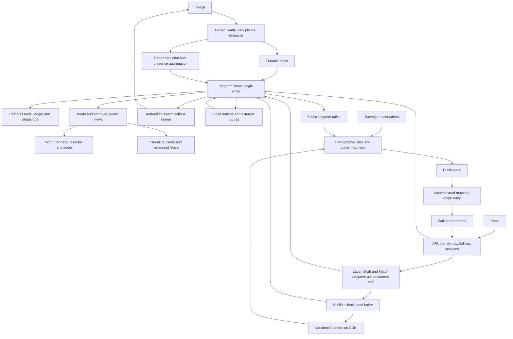

# Chatdom build map

Owner: `chatdom-main` · Written 2026-10-30 · Status: workspace scaffolded; first identity/event and Atlas interchange v1 frozen; Atlas ready for handoff.

This is the map of the whole build, not a release ladder. Dependencies determine what can run together; Tobias
chooses the next work. A small working scene is a proving ground for the full system, never a smaller product.
The source of truth is [ChatDom](../chatdom/ChatDom.md), then each topic's Decided list and latest change log.
[Decisions](DECISIONS.md) records implementation interpretations and unresolved tensions without silently rewriting
the vision. The old prototypes are references, not existing implementation in this repository.

## 1. What we are building

A place, a show, and a world connecting Twitch communities. All three must work through watching, chatting, and
walking. The nine promises in ChatDom §10 are acceptance journeys, not marketing copy:

| Promise | Systems that must meet |
|---|---|
| My light comes on, including when I lurk | Herald/panel presence → private citizen history → light field → stream view |
| My four years here are visible in my street | Identity/follow history → settlement → fixed tenure quarters → home/card |
| My words became a chimney unique to us | Coal ledger → judges → Codex plan → Forge grammar → publish → provenance |
| I built my own house block by block | Voxel engine → private durable draft → publish checks → street revision |
| Twitch moments become a show we join | Event inbox → world facts/crowd windows → spectacle → director/audio → keepsake |
| We sat at the fire with the streamer | Shared room/seats → Dusk Court → private game views → public invited voice |
| We rode out and left a road | Royal action → confirmed Twitch raid → voluntary travel → Atlas → passport/gifts |
| Our tiny kingdom won its league | Earned source ledger → size leagues → participation/beauty/play/visits → crowns |
| My home waited and I was welcomed back | Persistence → absence without loss → returning presence → welcome beat |

These apply to five viewers and fifty thousand. Bodies represent real people; a few clearly distinct keepers run
places. No invented audience. Every visible simulation is labelled **SIMULATED**.

## 2. The connected system

Postgres holds truth. Valkey carries notifications, presence and counters; losing it must not lose ownership,
progress or accepted work. Content is immutable and addressed by hash; publication and visibility are mutable
references. A moderation veil therefore withdraws access to all derivatives, even when their underlying bytes are
immutable. The event log holds game facts, not retained Twitch chat or microphone recordings.

`packages/shared` describes the boundaries; `packages/world` implements the authoritative domain rules. Renderers,
Twitch adapters, Codex and games cannot mint rewards or invent facts. Clients request; the writer validates and
commits; beats make the result visible. The Atlas consumes a public projection and never joins game rooms.
Small kingdoms carry walkers in KingdomRoom itself: 30 Hz fixed simulation and 5 Hz patches, with Colyseus
prediction/reconciliation. Only walkers have gameplay sockets; the rest of chat is represented by presence.
The private domain log, public durable deliveries and transient speech/seats are distinct projections.

## 3. Contracts to freeze here

The following are contract groups, not files already implemented. Main owns their schemas, examples, compatibility
rules and tests. Freeze each small group when its first consumer starts; do not freeze all groups up front.
Identity, Atlas, world/voxel, build/Forge and realm first-consumer boundaries now exist; specs name their exact exports.
Frozen means versioned and tested, not unchangeable: main owns migrations and updates dependent lane briefs.

| Contract | Lives in | What must be explicit | Unlocks |
|---|---|---|---|
| Identity, authority and privacy | `shared` + rules in `world` | String Twitch IDs; Person/Citizen/Kingdom/Local split; monarch/mod/Warden capabilities; trust separate from money; three-home cap and castle exception; anonymous light versus named identity; passport/home disclosure; consent and revocation | Every client, API, Herald, safety |
| Intent, fact, beat and time | `shared` + `world` | Idempotency/cause IDs; schema version; writer epoch and sequence; occurred/received/applied time; recovered/live/simulated origin; seeded RNG; durable timers; public/private projections; four beat levels; acknowledgements and retry semantics | Realm, Herald, director, Chronicle, tests |
| Presence and crowd participation | `shared` + `world` | One minute tick; chat/panel/walker dedupe; idle/stream-night rules; unnamed lurker accrual; one person/one vote across transports and layers; window deadlines, stream delay and ad pauses; moderation removals | Herald, panel, games, lights, progression |
| Ledger, ownership and provenance | `shared` + `world` | Source classes; money cannot mint standing; coal earn/reserve/consume/refund, cap 3, home eligibility and castle exception; equal event caps; item versus copy; portable versus kingdom-bound possessions; consented gifts/swaps; append-only story with identity redaction | Forge, content, play, seasons, travel |
| Atlas boundary — first independent freeze | `shared` | Edition/holding IDs; frozen geometry; pencil/ink/colour; tiles and versioned asset manifest; `live.bin` v2, dabs and map events; freshness/coverage; public pulse; privacy bands; card/search DTOs; hero drawing/entry descriptor; map links and travel IDs | Atlas immediately, kingdom integration independently |
| Twitch ingress and outbound actions | `shared` | Normalized event families; durable inbox versus transient text; transaction/event dedupe; reconciliation gaps; action request/result/unknown outcome; actor/consent/token scope; royal preview/confirmation; dev write allowlist; Extension identity and Bits receipt | Herald, API auth adapters, panel |
| Voxel, content and interaction | `shared`; algorithms in `voxel` | Units/lattices; chunk/CVOX format; material/style IDs; immutable asset manifest; structure versus pieces; carves/sockets/doors; occupancy/picking; interactions and animation/sound requirements; bounds/budgets; worker revisions | Content, baker, world builder, Forge |
| Draft and publication | `shared` + `world`/`voxel` | Ordered edit ops, ownership, acknowledgement and undo; IndexedDB pending ops; plot revision; support/egress checks; returning-citizen permission; approval states; last-approved fallback; atomic publish; invalidation of bakes | Build mode, DraftRoom, baker, Watch |
| Appearance and animation | `shared` + `anim` | Shared skeleton/part sockets; chibi proportion; face states; clip/action timing; stance and springs; appearance hash; person look versus local earned pieces; LODs; equal-brightness sub tint | Wardrobe, avatar content, crowds, voice |
| Making and judgment | `shared` | Pass/soften/hold/refuse; input/result checks outside agent; verdict/model/question-set versions; approved asset lineage; stream pass distinct from world publish; appeal/veil/revert; derivative invalidation; private refusal versus nameless beat | Forge, Genesis, games, build publishing, Watch |
| Realm/session/travel protocol | `shared` + authority in `world` | Room roles, seat leases/reconnects, layer membership, movement validation, rate/bandwidth caps, writer failover, cross-kingdom reservation and rollback, no forced travel, destination bans | Realtime clients, games, Raid Gate |
| Games and voice | `shared`; lane-local semantics in `packages/games` | Family/variant manifest, view classes, legal-move visibility, match commands/results, practice rewards, deadlines, spectator/stream views, miniature summary; invited seats, age/consent, LiveKit permission lifecycle | Tavern games, Taster, campfire, Royal Audience |
| Spells and founding | `shared` | HousePartPlan, Charter, family/Chalk plans, fact-cited Voice lines; deterministic tools; quotas/timeouts; two external gates; checked fallback; ritual progress as observations of work, never fake success | Codex runtime, Forge, Genesis, Voice |
| Seasons, discovery and memory | `shared` + `world` | Common league brackets, versioned score sources, contribution caps, visitor garlands, crowns, wonder progress; Chronicle/card/still records with fact and asset dependencies; privacy and retraction | Seasons, Chronicle, Atlas rankings, share surfaces |

Every contract freeze includes representative and hostile fixtures, visibility rules, failure/retry behavior,
budget limits, and a consumer example. No giant event union guessed from missing `docs/` files: derive the catalogue
from the current vision and preserve an explicit coverage table against Twitch §3 and World-Tree's seven branches.
No `Math.random`, wall-clock reads or render dependencies in deterministic packages.

## 4. What stays in this thread

Main owns integration and the systems whose feel and authority determine everything built on them. Astra at xhigh
is used for their architecture/core work, Sol at high for integration, Terra for disjoint visual/test work, and Luna
for recon. Sub-agents inside this checkout never run git. Lanes remain separate workers in separate worktrees.

### World truth and realtime

Main owns the pure reducer, ledger/ownership rules, provenance, authority contracts and reference room/client.
Spec 33 freezes the actual Colyseus schema, messages, immutable collision boundary and fenced repository ports.
The `realm-server` lane builds Postgres fencing/inbox/outbox/recovery and authenticated entry; `realm-wiring`
binds the existing systems to it. Only KingdomRoom is implemented now; LayerRoom, MatchRoom and DraftRoom
keep clean authority seams until their own consumers start. Private data never enters broadcast schemas.

The small-kingdom consumer targets 300 walkers in one room, 30 Hz movement and 5 Hz patches. One StateView is
shared per district interest set; measure the actual input/prediction path before claiming capacity. Larger
kingdom layering, royal first-come admission, friends following, mirrored ceremonial seats and crowd summaries
remain in the whole build without paid priority. Chatters are data, not one websocket each. Sleeping kingdoms
cost no resident room; their durable inbox survives. Live broadcasts wake the kingdom; reruns do not earn presence.

### Voxel world, lighting, avatars and build mode

Build the actual walkable kingdom: terrain and horizons, roads/tenure quarters, full reserved lots, structures and
placed pieces, enterable interiors, navigation, picking and shared solid occupancy. Terrain uses 0.5 m, building
and Forge parts 0.125 m, avatars/pets 0.0625 m. Lots reserve 8 × 16 × 20 m; growth moves the back fence, never a
neighbour. Ward expansion preserves old streets and addresses, including late-arriving long-time followers.

The mesher, baked AO, chunk workers, packed materials, LODs, light field, warm windows, fog, water, sky, weather and
painterly interiors must deliver the crafted toy kingdom at dusk. The light field is real scope, not optional
polish. Study external implementations before freezing these designs. Validate the rendering path in WebGL2/OBS
before prescribing a shader API; do not assume a library promise is working code.

Own the contracts and judge the free-cursor controls, collision-safe follow/orbit/dollhouse cameras, touch and
gamepad, action picking and local response. Specs 35/37 hand walking and interactions to the team on the shared
pure step; E is use, and wheel reaches first person. Own the chibi body/face builder, shared rig, layered distance-driven pose evaluator, capes/hair,
wardrobe composition and crowd renderer. All avatars are people, with individual timing, not synchronised dolls.
The tier-3 cape shimmers in palette colour, never extra glow. Content batches follow these contracts in lanes.

Own free voxel editing: brush sizes available immediately, place/shape/extrude/paint/erase/fill, pieces, select,
mirror/copy/blueprints, eyedropper, `.vox` import, private drafts, durable undo and publish. Authored detail adds
eaves/trim/sills without rewriting the citizen's structure. Forge doors/windows carve reversible openings.
Every usable-looking asset works. Every build has support and an escape path; publication never traps people.

### Forge grammar, Genesis and game-language authority

Main owns the fixed-shape Forge grammar, deterministic assembler and beauty checks, the Charter/layout generator
and shared promotions. Spec 22 delegates the full Chalk interpreter, view semantics and Taster core to
`lane/tavern-tables` in `packages/games`; main reviews those core rules before promoting their shared consumers.
Taster includes whole-family settings checks, fairness/termination and two-world trace/taint checks, including
legal moves and phase conditions that could disclose private state. The lane owns implementation, not only UI.

The full Forge scope includes the decided worn-piece branch on avatar sockets. Main owns its grammar/contract;
content and safety lanes own its authored pieces and dedicated golden set. House parts open first under the
founder's rule; worn pieces activate only when their own shapes and checks pass. Creatures never enter the Forge.
The spell contract must represent branch-specific plans without weakening the house-part schema.

Genesis reads the channel, gives checked name choices to chat, ranks landscapes, and creates its style, quarters,
landmarks, emote monuments and hero angles. The ceremony is live only, about 3–4 minutes including the 15-second
rise; at most two live redraws and a safe deterministic fallback at four minutes. Preparation is data gathering,
not a private founding. Once raised, the land stays put.

## 5. Whole-product work and lane boundaries

The paths below are proposed exclusive write scopes, to be created as needed. Shared files, package manifests,
root configuration, route registration and cross-lane composition stay with main unless a spec explicitly assigns
them. Multiple paths in a row form one bounded responsibility, not permission to edit their parent folders.
Split broad responsibilities into small PRDs (normally 3–6 tasks) as their contracts freeze.

| Lane / owner | Proposed scope | Complete responsibility | Needs |
|---|---|---|---|
| **Atlas — first handoff** | `apps/web/src/atlas/**`, `apps/surveyor/**` | Surveyor adapter; Cartographer; editions, language continents/game-family realms, fixed holdings and hamlet slots; tile baking and overlays; wash/pennants/dabs; roads/caravans/raid trains/bridges/trade routes; search, cards, public links, My Twitch, passport/friend privacy; crowns, Kingdom of the Week, map history; entry drawing/return/Raid Gate UI | Atlas boundary + shared identity/public view; no voxel runtime dependency |
| **Herald** | `apps/herald/**`, `packages/twitch/**` | Typed Helix/EventSub client, tiered grants adapter, conduit ingest, ephemeral chat, presence, reconciliation, token refresh/validation, outbound queue/budgets, confirmed actions, Extension transaction reconciliation | Identity/event/presence/action contracts; API token-store interface |
| **Panel** | `apps/panel/**`, `apps/api/src/panel/**` | Twitch Extension desktop/mobile/config/live config, identity sharing and light tap, home card, night painting, crowd acts, communal pool, tonight's moments, Bits shelf, PubSub, EBS verification and review package | Identity/presence/actions/receipts; panel DTOs; carved tokens; CDN stills |
| **API account surfaces** | `apps/api/src/accounts/**`, `apps/web/src/account/**` | OIDC/session claiming, consent UI, grants integration, quiet/forget/privacy, home choices, rename/revoke/delete/recovery and public-safe account projections | Main's auth/storage/capability contracts; no replacement world authority |
| **Carved UI** | `packages/ui/**` | Wood/brass/parchment/wax kit, type, drawn icon family, focus and input behavior, physical motion, responsive states and component gallery | Design tokens, action/sound hooks, interface inventory |
| **Content library** | Separate assigned subfolders of `packages/content/**` | Kingdom style kits, biomes, starter homes, civic places, furniture/tools, plants/wild species, companions, great beasts/dragon, wardrobe/tenure/sub pieces, curated flags, Forge motifs, emote uses, clips and seasonal decorations | Asset/interaction/rig/Forge contracts; visual benches |
| **Baker** | `apps/baker/**` | CVOX versions, plot/ward LODs and impostors, contact sheets, guarded publication, emote conversion, approved Atlas drawings from real geometry, derivatives and CDN invalidation | Voxel/assets/publication/judgment; main's render API |
| **Spell runtime and Watch** | `apps/codex/**`, `apps/api/src/watch/**`, `apps/web/src/watch/**` | API-key Codex workers/tools, bounded spell recipes, warm latency/cost tests, two independent gates, golden sets/drift checks, holds/appeals/rechecks, global veil and stream-pass workflows | Spell/grammar/judgment/authority contracts; approved renderer/assembler tools |
| **Games and tavern — Spec 22** | `packages/games/**` except `dusk-court/**`, `apps/taster/**`, `apps/web/src/tavern/**`, `apps/realm/src/matches/tavern/**`, `apps/codex/src/games/**` | Authored verified families; quiz/chalk/chess/dice/regatta and Dusk Court; four chat modes (one player/many/teams/seats); Tableware styles and miniatures; spectate/join/resume; prompt variants, promise checks, shelf, crown polish and travelling author credit; full new-rules path behind its evidence gate | Lane-local Chalk/view/result/Taster ports first; main promotes shared contracts and binds auth/store/transport |
| **Voice** | `apps/api/src/voice/**`, `apps/realm/src/voice/**`, `apps/web/src/voice/**` | Campfire and Royal Audience invitation, 16+ consent, trust/seat verification, PTT, permission revocation, OBS listening/monitoring and limiter; text seats; no recording | Seats/moderation/capability protocol; LiveKit adapter |
| **Throne** | `apps/web/src/throne/**`, `apps/api/src/throne/**` | Connect and live-founding controls; dock/tab/phone/Stream Deck; one-press royal acts with previews, suggestions capped at three, Busy, safe areas, stream pass, safety keys, cost display and lifecycle | Capabilities/confirmed action results/Genesis/director interfaces |
| **Director and stream** | `apps/web/src/stream/**`, `apps/web/src/director/**` | Beat-driven shot grammar, occlusion checks, calm/show, stage/corner/strip and seams, shutters, preloads, live Genesis direction, selected auto-open with veto, missed-climax in-app replay, OBS loss/recovery and long soak | Main's camera/render/beat/public projection; replay contract |
| **Audio** | `packages/audio/**`, assigned `packages/content/audio/**` | Material/interaction variation banks, spatial sources, presence-layered music, per-device decoding/unlock, limiter and distinct broadcast mix; playback of checked Voice lines | Action/clip/beat clocks; content/licensing decision |
| **Social life, wilds and progression** | `apps/realm/src/features/life/**`, `apps/web/src/life/**` | Friendship/consented paired acts, giving/tending, cross-kingdom swaps, companions and bonds, wild exploration/gathering, great beast, tools/toys, seasonal species, streaks/return welcomes, street and wonder contributions | Main's reducer/ledger/ownership/consent contracts; contributions request core facts |
| **Spectacles** | `apps/web/src/spectacles/**`, assigned `packages/content/spectacles/**` | Forge/housewarming/emote unveilings, gift parcels, emote weather, cheers/Power-ups/charity, Hype Train, earned dragon and free Wyrm Bell, raid arrivals, festivals and crowning; cause-to-peak-to-trace choreography | World facts/beat timing; content/animation/audio; paid/free cap rules |
| **Seasons and discovery** | `apps/realm/src/features/seasons/**`, `apps/web/src/seasons/**` | Shared size brackets, median-home beauty, breadth of participation, wonders, visitors/garlands, games/rating, opt-in contests/tournaments/build-offs, festivals/Long Night/Founding Day, citations/crowns and Kingdom of the Week | Ledger/source exclusions, season rules, Atlas projections |
| **Chronicle and cards** | `apps/api/src/memory/**`, `apps/web/src/memory/**` | Citizen cards/all eligible homes/passport, house plaques and guestbook, item lineage, Almanac/honours, nightly Ballad and stills, personal night cards/share images, Gallery of director stills and viewer clip links, weekly letters | Fact-cited memory, privacy, asset retraction and Voice contracts |
| **Studio** | `apps/studio/**` | Opted-in wire capture and retention, same-decoder replay, frame barriers, offline render/editor and labelled rehearsals; internal tooling only | Network versions, asset manifest, redaction, no-secret recording view |
| **Quality and operations** | Assigned `packages/testing/**` suites and `work/reviews/**`; operational tooling scoped separately | Collision/input/recovery/visual/beauty/privacy/load tests, device tour, backups/restore drills, metrics, runbooks, dependency/license inventory, rolling recovery and cost alarms | Contracts and runnable surfaces; deployment authority remains with main/team |

One lane never edits another lane's files. Feature lanes submit intents/results to the main-owned world package;
they cannot quietly grow alternate ledgers or reducers. Backend extensions import main-owned services through
explicit ports. Main registers them and reviews the integrated behavior before merging.

## 6. Breadth that must not fall through the seams

**Twitch coverage.** Preserve a test row for every Twitch §3 family: presence/chat/panel; follows/streaks;
subs/resubs/lapses/gifts; cheers/Power-ups/panel Bits/charity; live/offline/category/title/schedule; trains/goals/ads;
rewards/pool/polls/predictions/commands; raids/trains/shared chat/shoutouts; emotes/badges/mods/VIPs; deletes,
timeouts/bans/announcements/Shield. Missing authorization or API capability has an honest fallback. Recovered
events repair state without pretending the spectacle happened live. Twitch writes use the action service, even
when another doc describes the API as the caller. Paid actions are deduped and reconciled, never guessed successful.

**World depth.** Homes are personal; the streets are communal within their style; the monarch owns castle/plaza
design; everyone can contribute to wonders. Gifts are free, swaps require consent and happen only across kingdoms;
there is no trade currency or personal damage. Companions wait, bond by days, and neither die nor become purchases.
Wilds, native materials, weather, moon/hour habitats, shared great beasts, toys and tools give ordinary nights life.
Games occupy the tavern, campfire, arena, plaza and theatre as appropriate, rather than a detached menu.

**Safety and privacy.** Input and composed result checks cover all made things, including builds, names, signs,
notes, games, emote statues, drawings and spoken lines. Neither the creator agent nor an unchecked render can
approve itself. Failing checks keep the last safe version visible. Wardens decide holds only; Watch/mods retain
their own powers; royal acts remain monarch-only. A veil reaches copies, gifts, impostors, drawings, share cards,
Chronicles and replays. Report/appeal tooling, block/mute/harassment rules, age handling and data erasure need
their own complete contracts: Safety §7 lists unfinished design, not permission to omit it. Never show private
ballots, dice, voices or refusals in a stream client or recorder. Twitch moderation removes access/voice promptly;
it never destroys a home or brands someone forever.

**Money and earned history.** Coals come only from presence, one once 10 minutes qualify a stream night, capped
at three; roars open anvils only. Trust does not change vote weight or coal cap.
Subs add pieces, edge tint and one-time street influence within the follow-year quarter; lapses dim, never delete.
Bits give everyone a moment or a day-long effect, with no permanent buyer advantage. Equal keepsakes for a shared
moment are allowed. Pool contributions are communal, with breadth constraints; scoring must not turn a paid or
points-funded shortcut into bought glory. The exact pool-to-wonder/score relationship requires a core decision.

**Public discovery.** Day-map paint and pennants, fixed geography by edition, no people search or public follower
graph. Shared-citizen/settler figures start at 20 and use bands, with the specified opt-outs. Other homes are shown
only after first sign-in; passport is public with a hide switch. Private follows are used for My Twitch, not stored.
Settlers before kings, small live dabs and land by raid from Edition I are part of the map's actual data model.

**Failure and lifecycle.** Offline kingdoms remain visitable; absence never folds homes. Voluntarily leaving a home
to settle a fourth folds it whole and preserves its address; kingdom deletion preserves owners' homes as keepsakes.
Rename, revoke, disconnect, exhausted spell capacity, late Twitch events, lost seats, failed publication and a
crashed writer each need a designed outcome. Safe fallback Genesis and a cold Forge do not fake a successful spell.

**The realm's voice.** The spell-runtime lane owns checked, fact-cited text → speech through the provider adapter
specified in Tech (ElevenLabs), plus versioned audio caching and withdrawal. The audio lane plays that asset on the
shared cue; Chronicle keeps the approved words and stills. Streamer veto and safety checks precede publication.
No participant microphone recording is needed for this pipeline.

## 7. Parallel work from the start

This turn writes the map only. Next turn scaffolds. No lane is launched against imaginary contracts today.

1. **Main establishes the workspace and the first boundaries.** TypeScript/pnpm/Vite/Vitest/Playwright, schema
   checks and verification entry point; identity/event envelope and the narrow Atlas public contract first.
   Create actual files only for current work. Verify the documented package/runtime pins before adopting them.
2. **Atlas goes to the team first.** Freeze its contract and write its spec and Ralph PRD in that same turn. Its
   worker can build real cartography, tiles, data ingestion and public UI from Surveyor observations while main
   builds the world. An approved stamp is a valid pre-drawing state; do not fake a founded voxel kingdom.
3. **Research can run beside that immediately.** Independent agents study reference meshing/lighting, water/sky,
   animation/crowds, map interaction and networking; write source/license/technique notes before implementation
   specs freeze. Review the actual demos/frames as well as the algorithms. Prototype findings are indexed in
   [references/prototypes.md](references/prototypes.md).
4. **Herald and panel open together when their contracts exist.** Main freezes presence, capabilities, events,
   actions, Extension receipts and the API boundary; their specs go out in that turn. Herald uses recorded/CLI
   inputs and authorized live reads; panel uses validated DTOs, with simulations visibly labelled. Neither waits
   for a finished town. The real integration must then prove that one panel tap lights the same citizen once.
5. **Content, UI, audio and bake work fan out when their formats exist.** Main establishes scale/palette/rig,
   interactions and tools; artisans build and inspect disjoint batches while main stays on voxels, avatars and
   editing. UI tokens can serve Atlas/panel before the world is complete. Sound authorship is an open decision,
   not grounds to ship silent actions.
6. **Games, throne, runtime magic, Chronicle and other lanes follow their own dependency edges.** A frozen Chalk
   view/result boundary opens families/Taster; seat/capability boundaries open voice; fact/public-view boundaries
   open Chronicle and stream presentation. No need to wait for every upstream visual to be finished.

Each lane gets `work/specs/<nn>-<slug>.md`, `work/lanes/<name>/PRD.md`, `progress.txt`, a branch `lane/<name>` and
its own worktree. Main commits the contract/spec first; the team starts the worker. Once handed off, main reviews
and integrates rather than rebuilding the lane. A worker writes `needs:` for contract changes and takes another
unblocked task. Main resolves it and updates the contract; lanes do not patch `packages/shared` themselves.

## 8. How we prove it is real

`pnpm verify` will run typecheck, lint, tests, build and standard screenshots once scaffolded. Checks grow with the
surfaces, and must assert real outcomes. This planning commit has no executable app and cannot claim a green
product build. No empty tests or placeholder UI used as evidence.

| Evidence | What it must demonstrate |
|---|---|
| World/authority | Duplicate and reordered input cannot double-reward; simultaneous writers cannot commit; crash/replay has the same state; no money-to-standing path; private fields absent from public views |
| Solid world and input | Walk/camera through every door, wall and prop; soft-push without trapping; footsteps grounded; tools leave movement working; response under 100 ms; camera returns after every cinematic |
| Building and making | Disconnect/tab/server kills during edits, forge, publish and games preserve accepted work; last approved build remains visible during holds; edits acknowledge and reconcile; no unsafe intermediate asset escapes |
| Presentation | Noon/dusk/night fixed-camera views, close/medium/far crowds, shared painted interiors, animation/action/sound coverage, Forge/Genesis beauty batches, all empty/loading/error/offline states |
| Scale | Five-viewer hamlet and 50,000-viewer capital; walkers distinguished from chatters; 200-bot change-set and 1,000-bot milestone checks, plus larger capacity evidence; map traffic never becomes room traffic |
| Real Twitch | Duplicate webhook, reconnect gaps, revocation, rate exhaustion, API refusal, Bits reconciliation, panel identity and moderation; outbound tests only on `tobi4s_` |
| Operations | Backup restored, writer killed and recovered, safe rolling reconnect, published asset retracted everywhere, stream token rotated, OBS context loss/reload/hidden state and six-hour soak |

Look at screenshots with `view_image`: web 1440×900 and 390×844, stream 1920×1080, panel 318×496; also inspect the
corner/strip/dock and mobile Extension at their actual sizes. A screenshot is not an animation or audio review.
Run the same hand-played tour on gaming PC, everyday laptop, phone and OBS. SwiftShader proves deterministic
rendering and behavior here, not real-GPU frame time.

Targets from Quality/Tech remain targets until measured: laptop 60 fps, phone at least 30, OBS 1080p60 at roughly
4 ms GPU cost; no normal frame above twice target time. Keep scene/bundle/memory budgets executable. Preserve
charm on lower tiers: presence light, clay materials, animation, sound and crafted UI. Node 24 in Tech versus the
available Node 22, shader compatibility and contradictory loading estimates must be checked during scaffolding.

Operations are part of the build: Postgres backup/PITR and migrations, Valkey outage recovery, conduit canaries,
inbox/patch/spell latency metrics, error seals, cost alarms, retention/erasure and license inventories. Planned
hosting remains US East with R2/CDN and LiveKit. This map authorizes no deployment or server configuration.
Request infrastructure from the team when a concrete test needs it; do not substitute an in-memory success path.

## 9. Open decisions and doubts

| Question / tension | Owner and next evidence |
|---|---|
| Presence light — decided 2026-10-30 | Citizen’s own warm window, named up close; castle beacon is the kingdom’s light. Prove the dusk scene next. |
| Sound — decided; hero animation still open | CC0/permissive libraries plus procedural sound; every source in THIRD_PARTY.md; no silent actions. Hero animation still needs its bench. |
| Per-kingdom runtime AI budget | Main + Tobias; warm Forge/Genesis/variant calls measured for latency, tokens and daily load; free kingdoms need fair capacity/degradation without selling coals |
| Renderer/pins and real-device floor | Main; confirm WebGL2/OBS material path, installed versions and phone/Firefox/macOS OBS targets; current host is not the GPU mentioned in old measurements |
| Pool contribution versus earned score | Main domain spec; settle ledger treatment, contribution breadth/caps and one league bracket table before seasons or pool rewards can ship |
| General generated games | Spec 22/Taster lane; implement the full bounded new-rules path, but preserve the founder's activation gate: at least 60 of 100 real prompts pass all checks; verified variants still fulfil table requests |
| Voice/harassment/age/cross-kingdom moderation | Main safety spec and founder choices; Safety §7 is unfinished; explicitly design block/mute, consent, ban reach, appeals and failure policy before exposure |
| Twitch data to AI and retention | Team obtains the written/legal answers already requested by the vision; design provider/data boundaries and deletion independently; never infer consent from a code path |
| Day-long panel Bits outside Twitch | Twitch written answer; preserve configurable expiry/eligibility and exact receipts; no promise of approval or monetization eligibility yet |
| Atlas Edition I and observation coverage | Tobias decides edition founding; Atlas lane verifies actual Surveyor coverage/freshness, content labels and cap limitations; document counts/dates are not current evidence |
| Raid receiving policy, game adoption and recording retention | Resolve the remaining Tech §19 choices before those actions activate; author credit always travels; no auto-recording merely because Studio exists |
| Durable history and avatar collision conflicts | Implementation decisions in DECISIONS: acknowledge only durable accepted work; no slide-through escape; prove bounded avoidance/egress and recovery rather than relaxing Quality |
| Accessibility/photosensitivity | Quality §6 did not adopt a blanket rule; recommend a focused decision before fireworks/voice/UI freeze, while preserving its existing keyboard/touch/focus requirements |

The missing `docs/` research and old prototype timings are not dependencies to resurrect. Re-study the relevant
techniques in available source and current primary documentation at each freeze. Some apparent questions are
already settled: no royal coals, no subscriber vote weight, no night Atlas, no public video creation, no paid map
position, no creature Forge, no real crowd without real people. Do not reopen them by accident.

## 10. Current handoff — 2026-10-31

**Order:** Real-chat evening; glassy walk; town with love; hero anvil/dragon; deep interactions; one Twitch moment.
Goal active. Main carries evening/realm/walk and integrates reviewed work promptly; changed checks plus one looked
frame, no matrices/full-suite per change. One worker per active world lane, no new lanes. Founder sends the first
real chat line when available: do not wait, fake people/live state/coals, or ask again. FL03 readable carved build
tools merged and pushed; parked/incomplete campfire/table work remains outside main.

**Integrated:** RS07 district views, IN03 controls, FR03 audio, WB02 body/hair/eyes, BT04 publication, AtlasA03–A05,
E01 emotes, RG01 gate, founded collision; AH05 anvil exports, KL05 ground warmth, LD02 geography, GD01 meadow kit,
FL03 readable build labels/resting controls. Phone disabled-reason words remain the polish lane's next task.
Reviewed civic carts/stores now compose beside the installed first market stall through the founded provider:
two fixtures at[-13.5,9,3.5] and[-8.5,9,.5] in the actual adopted town. The pinned baseline/homes stay exact; public
scene digest/collision/adoption include the wares. Second-stall candidates are omitted for road/home clearance.
Passive flowers/tufts now mount over the actual adopted v1 plots/court and occupied geometry, using rendered ground
and shared lighting. Solid gardens wait for authoritative collision composition; homes/streets never move to a new
generator. Native founded compilation still consumes adopted v1 land. Market cart/worn planting is the ground
lane’s next visible task; AH04 gets a sleeping muzzle-on-paws silhouette separated from the current plate-ring.

**Authority/Forge:** Postgres/KingdomRoom owns allocation, presence, geometry and commits. Presence is durable;
speech/wishes/deletions transient. Chat grants no identity/history/rights/coals. Monarch keep is separate host65534,
with the same actual ten-minute coal rule; migration0007 applied. Host fingerprints stay pinned through judgment,
commit and landing. Current path is Herald→room→real Codex CLI/judges→owned host→public ritual/director, still
unproved on real chat. Room-fed casting now heats the physical engraved anvil through pour/cooling without duplicate
effects; camera includes the crucible/bail. Dragon finishes/inlays preserve horns, stack and authored detail.

**Citizens/walking:** Appended WalkerSchema.homeSlot (65535=no street home) follows committed ownership through
join/allocation/reconnect; replacement removes the previous body. Six free starter looks derive from verified
identity and use reviewed wardrobe parts across chat/walking without private IDs in public frames. Actual feet
replace only their linked representative body/shadow; speech/camera follows the walker, presence still owns its
window. Bounded public5Hz `walkers` SSE adds no spectator player/socket/crowd transforms; scope/revisions/freshness
clear stale bodies. Read-only250ms interpolation clamps/cuts on placements; physical Predict is unchanged. Existing
glassy pass and material footsteps stand. One shared seated-pose resolver now uses witnessed room leases and the
installed registry's rest/facing for walkers, stream, names and speech. Renderer bends knees, plants soles and
blends posture over280ms; room collision stays at the safe approach. Optional bounded public frame `seats` is copied
from the actual lease book, never the movement publisher; older writers imply standing. Native targets remain
anvil/own door/exit only: installed producer anchors still needed. `rest` means sole datum; legacy log examples
using seat-top height must be corrected before mounting. Main took this runtime seam; interactions owns the places.

**Landscape sound:** Actual feet (stream: camera) now feed shore-distance/direction and outdoor exposure into
bounded wind/water phrases through the existing audio mixer: two sources/phrase,3.2s lifetime,1.6s cadence,
equal-power overlap, no catch-up/queue/new context. Page hide drains the shared mix; restore preserves explicit mute.
Original synthesis, MDN technique study/CC0 credit in THIRD_PARTY and references/kingdom-ambience.md. The22s
`shots/audio/landscape-tour.wav` uses the live adopted plan with SIMULATED sampled locations and the real offline
mixer:13/13 admissions, browser errors0, mute16–18s silent after fade; town RMS0.000369, lake0.004077. Not listened
to on this host; wind intentionally very quiet. No listening-quality claim; audition at normal/quiet PC levels.

**Runtime/open:** Managed main-checkout preview5190, API5196, realm5197(root env mode/schema), Forge5195,
Herald5194; restart after main/env changes, one live writer. Origin exactly http://localhost:5190. Old simulated5191
gone, spare5198 stopped; explicit SIMULATED rehearsal5187 remains. Leave managed processes alone. Entry/session and
public checkpoint/`walkers` work; Herald healthy, no pending/faults, no observed chat yet, stream offline. Ordinary
observed chat may warm a window offline; beacon/coals/Forge need observed live. Bench5195 CLI status alone is not
room Forge proof. Walk: `/?walk=1&kingdom=129634568&hour=19.5` (genuine Twitch sign-in); watch:
`/stream?source=realm&kingdom=129634568&hour=19.5`.

**Evidence/next:** Root looked at `shots/citizens/seated@1440x900.png`: six reviewed looks, explicitly SIMULATED
bench/people review; planted feet/readable bent knees, hands still stiff, rear cape clearance unproved. FL03's
looked comparison is `work/evidence/first-look-polish/fl03/zoom-sheet.png`. Previous actual town and Forge frames:
`shots/kingdom/live-evening/adopted-cover@1440x900.png`, `shots/forge/room-hot-pour-framed@1440x900.png` and
`shots/forge/room-cool@1440x900.png`. Flowers soften fronts but town too tidy/empty; dragon still weak. Changed
contract/watch/pose/citizen/footstep checks, typecheck, scoped lint and web/realm builds cover this slice, not a full verify.
Market composition/provider checks(3), typecheck, scoped lint and realm build pass; selected live market capture:
`shots/kingdom/live-evening/market-wares@1440x900.png`. Ground lane keeps planting/wear, not a duplicate civic cart.
Next acceptance remains real chat→shared arrival/window/bubble, real wish→judged piece→right home, two/three real
walkers/director, then record and watch60–90seconds. No full evening capture or real-GPU smoothness acceptance yet.
