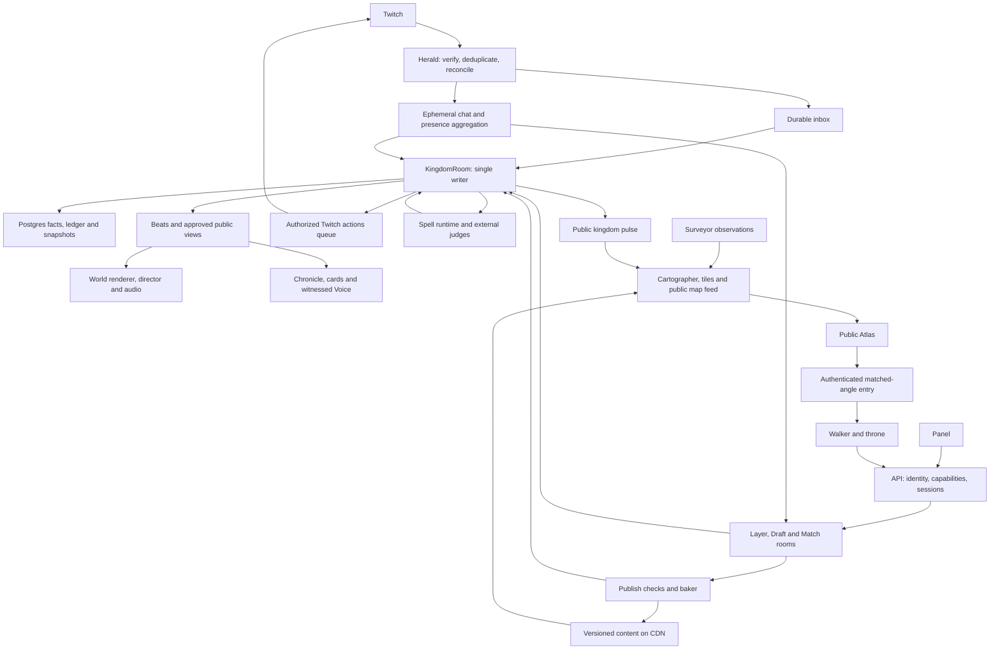

# Chatdom build map

Owner: `chatdom-main` · Written 2026-10-30 · Status: workspace scaffolded; first identity/event and Atlas interchange v1 frozen; Atlas ready for handoff.

This is the map of the whole build, not a release ladder. Dependencies determine what can run together; Tobias
chooses the next work. A small working scene is a proving ground for the full system, never a smaller product.
The source of truth is [ChatDom](../chatdom/ChatDom.md), then each topic's Decided list and latest change log.
[Decisions](DECISIONS.md) records implementation interpretations and unresolved tensions without silently rewriting
the vision. The old prototypes are references, not existing implementation in this repository.

## 1. What we are building

A place, a show, and a world connecting Twitch communities. All three must work through watching, chatting, and
walking. The nine promises in ChatDom §10 are acceptance journeys, not marketing copy:

| Promise | Systems that must meet |
|---|---|
| My light comes on, including when I lurk | Herald/panel presence → private citizen history → light field → stream view |
| My four years here are visible in my street | Identity/follow history → settlement → fixed tenure quarters → home/card |
| My words became a chimney unique to us | Coal ledger → judges → Codex plan → Forge grammar → publish → provenance |
| I built my own house block by block | Voxel engine → private durable draft → publish checks → street revision |
| Twitch moments become a show we join | Event inbox → world facts/crowd windows → spectacle → director/audio → keepsake |
| We sat at the fire with the streamer | Shared room/seats → Dusk Court → private game views → public invited voice |
| We rode out and left a road | Royal action → confirmed Twitch raid → voluntary travel → Atlas → passport/gifts |
| Our tiny kingdom won its league | Earned source ledger → size leagues → participation/beauty/play/visits → crowns |
| My home waited and I was welcomed back | Persistence → absence without loss → returning presence → welcome beat |

These apply to five viewers and fifty thousand. Bodies represent real people; a few clearly distinct keepers run
places. No invented audience. Every visible simulation is labelled **SIMULATED**.

## 2. The connected system

Postgres holds truth. Valkey carries notifications, presence and counters; losing it must not lose ownership,
progress or accepted work. Content is immutable and addressed by hash; publication and visibility are mutable
references. A moderation veil therefore withdraws access to all derivatives, even when their underlying bytes are
immutable. The event log holds game facts, not retained Twitch chat or microphone recordings.

`packages/shared` describes the boundaries; `packages/world` implements the authoritative domain rules. Renderers,
Twitch adapters, Codex and games cannot mint rewards or invent facts. Clients request; the writer validates and
commits; beats make the result visible. The Atlas consumes a public projection and never joins game rooms.

## 3. Contracts to freeze here

The following are contract groups, not files already implemented. Main owns their schemas, examples, compatibility
rules and tests. Freeze each small group when its first consumer starts; do not freeze all groups up front. World/voxel comes next after this first Atlas handoff.
Frozen means versioned and tested, not unchangeable: main owns migrations and updates dependent lane briefs.

| Contract | Lives in | What must be explicit | Unlocks |
|---|---|---|---|
| Identity, authority and privacy | `shared` + rules in `world` | String Twitch IDs; Person/Citizen/Kingdom/Local split; monarch/mod/Warden capabilities; trust separate from money; three-home cap and castle exception; anonymous light versus named identity; passport/home disclosure; consent and revocation | Every client, API, Herald, safety |
| Intent, fact, beat and time | `shared` + `world` | Idempotency/cause IDs; schema version; writer epoch and sequence; occurred/received/applied time; recovered/live/simulated origin; seeded RNG; durable timers; public/private projections; four beat levels; acknowledgements and retry semantics | Realm, Herald, director, Chronicle, tests |
| Presence and crowd participation | `shared` + `world` | One minute tick; chat/panel/walker dedupe; idle/stream-night rules; unnamed lurker accrual; one person/one vote across transports and layers; window deadlines, stream delay and ad pauses; moderation removals | Herald, panel, games, lights, progression |
| Ledger, ownership and provenance | `shared` + `world` | Source classes; money cannot mint standing; coal earn/reserve/consume/refund, cap 3, home eligibility and castle exception; equal event caps; item versus copy; portable versus kingdom-bound possessions; consented gifts/swaps; append-only story with identity redaction | Forge, content, play, seasons, travel |
| Atlas boundary — first independent freeze | `shared` | Edition/holding IDs; frozen geometry; pencil/ink/colour; tiles and versioned asset manifest; `live.bin` v2, dabs and map events; freshness/coverage; public pulse; privacy bands; card/search DTOs; hero drawing/entry descriptor; map links and travel IDs | Atlas immediately, kingdom integration independently |
| Twitch ingress and outbound actions | `shared` | Normalized event families; durable inbox versus transient text; transaction/event dedupe; reconciliation gaps; action request/result/unknown outcome; actor/consent/token scope; royal preview/confirmation; dev write allowlist; Extension identity and Bits receipt | Herald, API auth adapters, panel |
| Voxel, content and interaction | `shared`; algorithms in `voxel` | Units/lattices; chunk/CVOX format; material/style IDs; immutable asset manifest; structure versus pieces; carves/sockets/doors; occupancy/picking; interactions and animation/sound requirements; bounds/budgets; worker revisions | Content, baker, world builder, Forge |
| Draft and publication | `shared` + `world`/`voxel` | Ordered edit ops, ownership, acknowledgement and undo; IndexedDB pending ops; plot revision; support/egress checks; returning-citizen permission; approval states; last-approved fallback; atomic publish; invalidation of bakes | Build mode, DraftRoom, baker, Watch |
| Appearance and animation | `shared` + `anim` | Shared skeleton/part sockets; chibi proportion; face states; clip/action timing; stance and springs; appearance hash; person look versus local earned pieces; LODs; equal-brightness sub tint | Wardrobe, avatar content, crowds, voice |
| Making and judgment | `shared` | Pass/soften/hold/refuse; input/result checks outside agent; verdict/model/question-set versions; approved asset lineage; stream pass distinct from world publish; appeal/veil/revert; derivative invalidation; private refusal versus nameless beat | Forge, Genesis, games, build publishing, Watch |
| Realm/session/travel protocol | `shared` + authority in `world` | Room roles, seat leases/reconnects, layer membership, movement validation, rate/bandwidth caps, writer failover, cross-kingdom reservation and rollback, no forced travel, destination bans | Realtime clients, games, Raid Gate |
| Games and voice | `shared`; semantics in `chalk` | Family/variant manifest, view classes, legal-move visibility, match commands/results, practice rewards, deadlines, spectator/stream views, miniature summary; invited seats, age/consent, LiveKit permission lifecycle | Tavern games, Taster, campfire, Royal Audience |
| Spells and founding | `shared` | HousePartPlan, Charter, family/Chalk plans, fact-cited Voice lines; deterministic tools; quotas/timeouts; two external gates; checked fallback; ritual progress as observations of work, never fake success | Codex runtime, Forge, Genesis, Voice |
| Seasons, discovery and memory | `shared` + `world` | Common league brackets, versioned score sources, contribution caps, visitor garlands, crowns, wonder progress; Chronicle/card/still records with fact and asset dependencies; privacy and retraction | Seasons, Chronicle, Atlas rankings, share surfaces |

Every contract freeze includes representative and hostile fixtures, visibility rules, failure/retry behavior,
budget limits, and a consumer example. No giant event union guessed from missing `docs/` files: derive the catalogue
from the current vision and preserve an explicit coverage table against Twitch §3 and World-Tree's seven branches.
No `Math.random`, wall-clock reads or render dependencies in deterministic packages.

## 4. What stays in this thread

Main owns integration and the systems whose feel and authority determine everything built on them. Astra at xhigh
is used for their architecture/core work, Sol at high for integration, Terra for disjoint visual/test work, and Luna
for recon. Sub-agents inside this checkout never run git. Lanes remain separate workers in separate worktrees.

### World truth and realtime

Build the pure reducer, seeded simulation, ledger, durable scheduler, identity and settlement rules, provenance,
world lifecycle, and beats. Build the Postgres writer fencing/inbox/outbox/recovery foundation and the four room
adapters: KingdomRoom, LayerRoom, MatchRoom and DraftRoom. Private data never enters broadcast schemas.

Layers hold about 300 walkers, with a hard cap of 400 as the starting budget. Nearest-avatar interest views, royal
layer first-come admission, friends following, mirrored ceremonial seats, crowd summaries and reconnects must all
work without paid priority. Chatters are data, not one websocket each. Sleeping kingdoms cost no resident room;
their durable inbox survives. Live broadcasts wake the kingdom; reruns do not earn presence.

### Voxel world, lighting, avatars and build mode

Build the actual walkable kingdom: terrain and horizons, roads/tenure quarters, full reserved lots, structures and
placed pieces, enterable interiors, navigation, picking and shared solid occupancy. Terrain uses 0.5 m, building
and Forge parts 0.125 m, avatars/pets 0.0625 m. Lots reserve 8 × 16 × 20 m; growth moves the back fence, never a
neighbour. Ward expansion preserves old streets and addresses, including late-arriving long-time followers.

The mesher, baked AO, chunk workers, packed materials, LODs, light field, warm windows, fog, water, sky, weather and
painterly interiors must deliver the crafted toy kingdom at dusk. The light field is real scope, not optional
polish. Study external implementations before freezing these designs. Validate the rendering path in WebGL2/OBS
before prescribing a shader API; do not assume a library promise is working code.

Own the free-cursor controls, collision-safe follow/orbit/dollhouse cameras, touch and gamepad, action picking and
local response. Own the chibi body/face builder, shared rig, layered distance-driven pose evaluator, capes/hair,
wardrobe composition and crowd renderer. All avatars are people, with individual timing, not synchronised dolls.
The tier-3 cape shimmers in palette colour, never extra glow. Content batches follow these contracts in lanes.

Own free voxel editing: brush sizes available immediately, place/shape/extrude/paint/erase/fill, pieces, select,
mirror/copy/blueprints, eyedropper, `.vox` import, private drafts, durable undo and publish. Authored detail adds
eaves/trim/sills without rewriting the citizen's structure. Forge doors/windows carve reversible openings.
Every usable-looking asset works. Every build has support and an escape path; publication never traps people.

### Forge grammar, Genesis and game-language authority

Main freezes and proves the fixed-shape Forge grammar, deterministic assembler and beauty checks, the Charter/layout
generator, and Chalk's total interpreter/view semantics and Taster verification core. These are core rules, not
handed to a UI lane to improvise. Taster includes whole-family settings checks, fairness/termination and two-world
trace/taint checks, including legal moves and phase conditions that could disclose private state.
Implementation of the spell service, content library and games can then proceed independently.

The full Forge scope includes the decided worn-piece branch on avatar sockets. Main owns its grammar/contract;
content and safety lanes own its authored pieces and dedicated golden set. House parts open first under the
founder's rule; worn pieces activate only when their own shapes and checks pass. Creatures never enter the Forge.
The spell contract must represent branch-specific plans without weakening the house-part schema.

Genesis reads the channel, gives checked name choices to chat, ranks landscapes, and creates its style, quarters,
landmarks, emote monuments and hero angles. The ceremony is live only, about 3–4 minutes including the 15-second
rise; at most two live redraws and a safe deterministic fallback at four minutes. Preparation is data gathering,
not a private founding. Once raised, the land stays put.

## 5. Whole-product work and lane boundaries

The paths below are proposed exclusive write scopes, to be created as needed. Shared files, package manifests,
root configuration, route registration and cross-lane composition stay with main unless a spec explicitly assigns
them. Multiple paths in a row form one bounded responsibility, not permission to edit their parent folders.
Split broad responsibilities into small PRDs (normally 3–6 tasks) as their contracts freeze.

| Lane / owner | Proposed scope | Complete responsibility | Needs |
|---|---|---|---|
| **Atlas — first handoff** | `apps/web/src/atlas/**`, `apps/surveyor/**` | Surveyor adapter; Cartographer; editions, language continents/game-family realms, fixed holdings and hamlet slots; tile baking and overlays; wash/pennants/dabs; roads/caravans/raid trains/bridges/trade routes; search, cards, public links, My Twitch, passport/friend privacy; crowns, Kingdom of the Week, map history; entry drawing/return/Raid Gate UI | Atlas boundary + shared identity/public view; no voxel runtime dependency |
| **Herald** | `apps/herald/**`, `packages/twitch/**` | Typed Helix/EventSub client, tiered grants adapter, conduit ingest, ephemeral chat, presence, reconciliation, token refresh/validation, outbound queue/budgets, confirmed actions, Extension transaction reconciliation | Identity/event/presence/action contracts; API token-store interface |
| **Panel** | `apps/panel/**`, `apps/api/src/panel/**` | Twitch Extension desktop/mobile/config/live config, identity sharing and light tap, home card, night painting, crowd acts, communal pool, tonight's moments, Bits shelf, PubSub, EBS verification and review package | Identity/presence/actions/receipts; panel DTOs; carved tokens; CDN stills |
| **API account surfaces** | `apps/api/src/accounts/**`, `apps/web/src/account/**` | OIDC/session claiming, consent UI, grants integration, quiet/forget/privacy, home choices, rename/revoke/delete/recovery and public-safe account projections | Main's auth/storage/capability contracts; no replacement world authority |
| **Carved UI** | `packages/ui/**` | Wood/brass/parchment/wax kit, type, drawn icon family, focus and input behavior, physical motion, responsive states and component gallery | Design tokens, action/sound hooks, interface inventory |
| **Content library** | Separate assigned subfolders of `packages/content/**` | Kingdom style kits, biomes, starter homes, civic places, furniture/tools, plants/wild species, companions, great beasts/dragon, wardrobe/tenure/sub pieces, curated flags, Forge motifs, emote uses, clips and seasonal decorations | Asset/interaction/rig/Forge contracts; visual benches |
| **Baker** | `apps/baker/**` | CVOX versions, plot/ward LODs and impostors, contact sheets, guarded publication, emote conversion, approved Atlas drawings from real geometry, derivatives and CDN invalidation | Voxel/assets/publication/judgment; main's render API |
| **Spell runtime and Watch** | `apps/codex/**`, `apps/api/src/watch/**`, `apps/web/src/watch/**` | API-key Codex workers/tools, bounded spell recipes, warm latency/cost tests, two independent gates, golden sets/drift checks, holds/appeals/rechecks, global veil and stream-pass workflows | Spell/grammar/judgment/authority contracts; approved renderer/assembler tools |
| **Games and tavern** | `packages/chalk/src/families/**`, `apps/taster/**`, `apps/web/src/games/**`, `apps/realm/src/matches/families/**` | Authored verified families; quiz/chalk/chess/dice/regatta and Dusk Court; four chat modes (one player/many/teams/seats); Tableware styles and miniatures; spectate/join/resume; prompt variants, promise checks, shelf, crown polish and travelling author credit; full new-rules path behind its evidence gate | Main's Chalk/Trestle/view/seat/result contracts; art library and Taster core |
| **Voice** | `apps/api/src/voice/**`, `apps/realm/src/voice/**`, `apps/web/src/voice/**` | Campfire and Royal Audience invitation, 16+ consent, trust/seat verification, PTT, permission revocation, OBS listening/monitoring and limiter; text seats; no recording | Seats/moderation/capability protocol; LiveKit adapter |
| **Throne** | `apps/web/src/throne/**`, `apps/api/src/throne/**` | Connect and live-founding controls; dock/tab/phone/Stream Deck; one-press royal acts with previews, suggestions capped at three, Busy, safe areas, stream pass, safety keys, cost display and lifecycle | Capabilities/confirmed action results/Genesis/director interfaces |
| **Director and stream** | `apps/web/src/stream/**`, `apps/web/src/director/**` | Beat-driven shot grammar, occlusion checks, calm/show, stage/corner/strip and seams, shutters, preloads, live Genesis direction, selected auto-open with veto, missed-climax in-app replay, OBS loss/recovery and long soak | Main's camera/render/beat/public projection; replay contract |
| **Audio** | `packages/audio/**`, assigned `packages/content/audio/**` | Material/interaction variation banks, spatial sources, presence-layered music, per-device decoding/unlock, limiter and distinct broadcast mix; playback of checked Voice lines | Action/clip/beat clocks; content/licensing decision |
| **Social life, wilds and progression** | `apps/realm/src/features/life/**`, `apps/web/src/life/**` | Friendship/consented paired acts, giving/tending, cross-kingdom swaps, companions and bonds, wild exploration/gathering, great beast, tools/toys, seasonal species, streaks/return welcomes, street and wonder contributions | Main's reducer/ledger/ownership/consent contracts; contributions request core facts |
| **Spectacles** | `apps/web/src/spectacles/**`, assigned `packages/content/spectacles/**` | Forge/housewarming/emote unveilings, gift parcels, emote weather, cheers/Power-ups/charity, Hype Train, earned dragon and free Wyrm Bell, raid arrivals, festivals and crowning; cause-to-peak-to-trace choreography | World facts/beat timing; content/animation/audio; paid/free cap rules |
| **Seasons and discovery** | `apps/realm/src/features/seasons/**`, `apps/web/src/seasons/**` | Shared size brackets, median-home beauty, breadth of participation, wonders, visitors/garlands, games/rating, opt-in contests/tournaments/build-offs, festivals/Long Night/Founding Day, citations/crowns and Kingdom of the Week | Ledger/source exclusions, season rules, Atlas projections |
| **Chronicle and cards** | `apps/api/src/memory/**`, `apps/web/src/memory/**` | Citizen cards/all eligible homes/passport, house plaques and guestbook, item lineage, Almanac/honours, nightly Ballad and stills, personal night cards/share images, Gallery of director stills and viewer clip links, weekly letters | Fact-cited memory, privacy, asset retraction and Voice contracts |
| **Studio** | `apps/studio/**` | Opted-in wire capture and retention, same-decoder replay, frame barriers, offline render/editor and labelled rehearsals; internal tooling only | Network versions, asset manifest, redaction, no-secret recording view |
| **Quality and operations** | Assigned `packages/testing/**` suites and `work/reviews/**`; operational tooling scoped separately | Collision/input/recovery/visual/beauty/privacy/load tests, device tour, backups/restore drills, metrics, runbooks, dependency/license inventory, rolling recovery and cost alarms | Contracts and runnable surfaces; deployment authority remains with main/team |

One lane never edits another lane's files. Feature lanes submit intents/results to the main-owned world package;
they cannot quietly grow alternate ledgers or reducers. Backend extensions import main-owned services through
explicit ports. Main registers them and reviews the integrated behavior before merging.

## 6. Breadth that must not fall through the seams

**Twitch coverage.** Preserve a test row for every Twitch §3 family: presence/chat/panel; follows/streaks;
subs/resubs/lapses/gifts; cheers/Power-ups/panel Bits/charity; live/offline/category/title/schedule; trains/goals/ads;
rewards/pool/polls/predictions/commands; raids/trains/shared chat/shoutouts; emotes/badges/mods/VIPs; deletes,
timeouts/bans/announcements/Shield. Missing authorization or API capability has an honest fallback. Recovered
events repair state without pretending the spectacle happened live. Twitch writes use the action service, even
when another doc describes the API as the caller. Paid actions are deduped and reconciled, never guessed successful.

**World depth.** Homes are personal; the streets are communal within their style; the monarch owns castle/plaza
design; everyone can contribute to wonders. Gifts are free, swaps require consent and happen only across kingdoms;
there is no trade currency or personal damage. Companions wait, bond by days, and neither die nor become purchases.
Wilds, native materials, weather, moon/hour habitats, shared great beasts, toys and tools give ordinary nights life.
Games occupy the tavern, campfire, arena, plaza and theatre as appropriate, rather than a detached menu.

**Safety and privacy.** Input and composed result checks cover all made things, including builds, names, signs,
notes, games, emote statues, drawings and spoken lines. Neither the creator agent nor an unchecked render can
approve itself. Failing checks keep the last safe version visible. Wardens decide holds only; Watch/mods retain
their own powers; royal acts remain monarch-only. A veil reaches copies, gifts, impostors, drawings, share cards,
Chronicles and replays. Report/appeal tooling, block/mute/harassment rules, age handling and data erasure need
their own complete contracts: Safety §7 lists unfinished design, not permission to omit it. Never show private
ballots, dice, voices or refusals in a stream client or recorder. Twitch moderation removes access/voice promptly;
it never destroys a home or brands someone forever.

**Money and earned history.** Coals come only from presence, one once 10 minutes qualify a stream night, capped
at three; roars open anvils only. Trust does not change vote weight or coal cap.
Subs add pieces, edge tint and one-time street influence within the follow-year quarter; lapses dim, never delete.
Bits give everyone a moment or a day-long effect, with no permanent buyer advantage. Equal keepsakes for a shared
moment are allowed. Pool contributions are communal, with breadth constraints; scoring must not turn a paid or
points-funded shortcut into bought glory. The exact pool-to-wonder/score relationship requires a core decision.

**Public discovery.** Day-map paint and pennants, fixed geography by edition, no people search or public follower
graph. Shared-citizen/settler figures start at 20 and use bands, with the specified opt-outs. Other homes are shown
only after first sign-in; passport is public with a hide switch. Private follows are used for My Twitch, not stored.
Settlers before kings, small live dabs and land by raid from Edition I are part of the map's actual data model.

**Failure and lifecycle.** Offline kingdoms remain visitable; absence never folds homes. Voluntarily leaving a home
to settle a fourth folds it whole and preserves its address; kingdom deletion preserves owners' homes as keepsakes.
Rename, revoke, disconnect, exhausted spell capacity, late Twitch events, lost seats, failed publication and a
crashed writer each need a designed outcome. Safe fallback Genesis and a cold Forge do not fake a successful spell.

**The realm's voice.** The spell-runtime lane owns checked, fact-cited text → speech through the provider adapter
specified in Tech (ElevenLabs), plus versioned audio caching and withdrawal. The audio lane plays that asset on the
shared cue; Chronicle keeps the approved words and stills. Streamer veto and safety checks precede publication.
No participant microphone recording is needed for this pipeline.

## 7. Parallel work from the start

This turn writes the map only. Next turn scaffolds. No lane is launched against imaginary contracts today.

1. **Main establishes the workspace and the first boundaries.** TypeScript/pnpm/Vite/Vitest/Playwright, schema
   checks and verification entry point; identity/event envelope and the narrow Atlas public contract first.
   Create actual files only for current work. Verify the documented package/runtime pins before adopting them.
2. **Atlas goes to the team first.** Freeze its contract and write its spec and Ralph PRD in that same turn. Its
   worker can build real cartography, tiles, data ingestion and public UI from Surveyor observations while main
   builds the world. An approved stamp is a valid pre-drawing state; do not fake a founded voxel kingdom.
3. **Research can run beside that immediately.** Independent agents study reference meshing/lighting, water/sky,
   animation/crowds, map interaction and networking; write source/license/technique notes before implementation
   specs freeze. Review the actual demos/frames as well as the algorithms. Prototype findings are indexed in
   [references/prototypes.md](references/prototypes.md).
4. **Herald and panel open together when their contracts exist.** Main freezes presence, capabilities, events,
   actions, Extension receipts and the API boundary; their specs go out in that turn. Herald uses recorded/CLI
   inputs and authorized live reads; panel uses validated DTOs, with simulations visibly labelled. Neither waits
   for a finished town. The real integration must then prove that one panel tap lights the same citizen once.
5. **Content, UI, audio and bake work fan out when their formats exist.** Main establishes scale/palette/rig,
   interactions and tools; artisans build and inspect disjoint batches while main stays on voxels, avatars and
   editing. UI tokens can serve Atlas/panel before the world is complete. Sound authorship is an open decision,
   not grounds to ship silent actions.
6. **Games, throne, runtime magic, Chronicle and other lanes follow their own dependency edges.** A frozen Chalk
   view/result boundary opens families/Taster; seat/capability boundaries open voice; fact/public-view boundaries
   open Chronicle and stream presentation. No need to wait for every upstream visual to be finished.

Each lane gets `work/specs/<nn>-<slug>.md`, `work/lanes/<name>/PRD.md`, `progress.txt`, a branch `lane/<name>` and
its own worktree. Main commits the contract/spec first; the team starts the worker. Once handed off, main reviews
and integrates rather than rebuilding the lane. A worker writes `needs:` for contract changes and takes another
unblocked task. Main resolves it and updates the contract; lanes do not patch `packages/shared` themselves.

## 8. How we prove it is real

`pnpm verify` will run typecheck, lint, tests, build and standard screenshots once scaffolded. Checks grow with the
surfaces, and must assert real outcomes. This planning commit has no executable app and cannot claim a green
product build. No empty tests or placeholder UI used as evidence.

| Evidence | What it must demonstrate |
|---|---|
| World/authority | Duplicate and reordered input cannot double-reward; simultaneous writers cannot commit; crash/replay has the same state; no money-to-standing path; private fields absent from public views |
| Solid world and input | Walk/camera through every door, wall and prop; soft-push without trapping; footsteps grounded; tools leave movement working; response under 100 ms; camera returns after every cinematic |
| Building and making | Disconnect/tab/server kills during edits, forge, publish and games preserve accepted work; last approved build remains visible during holds; edits acknowledge and reconcile; no unsafe intermediate asset escapes |
| Presentation | Noon/dusk/night fixed-camera views, close/medium/far crowds, shared painted interiors, animation/action/sound coverage, Forge/Genesis beauty batches, all empty/loading/error/offline states |
| Scale | Five-viewer hamlet and 50,000-viewer capital; walkers distinguished from chatters; 200-bot change-set and 1,000-bot milestone checks, plus larger capacity evidence; map traffic never becomes room traffic |
| Real Twitch | Duplicate webhook, reconnect gaps, revocation, rate exhaustion, API refusal, Bits reconciliation, panel identity and moderation; outbound tests only on `tobi4s_` |
| Operations | Backup restored, writer killed and recovered, safe rolling reconnect, published asset retracted everywhere, stream token rotated, OBS context loss/reload/hidden state and six-hour soak |

Look at screenshots with `view_image`: web 1440×900 and 390×844, stream 1920×1080, panel 318×496; also inspect the
corner/strip/dock and mobile Extension at their actual sizes. A screenshot is not an animation or audio review.
Run the same hand-played tour on gaming PC, everyday laptop, phone and OBS. SwiftShader proves deterministic
rendering and behavior here, not real-GPU frame time.

Targets from Quality/Tech remain targets until measured: laptop 60 fps, phone at least 30, OBS 1080p60 at roughly
4 ms GPU cost; no normal frame above twice target time. Keep scene/bundle/memory budgets executable. Preserve
charm on lower tiers: presence light, clay materials, animation, sound and crafted UI. Node 24 in Tech versus the
available Node 22, shader compatibility and contradictory loading estimates must be checked during scaffolding.

Operations are part of the build: Postgres backup/PITR and migrations, Valkey outage recovery, conduit canaries,
inbox/patch/spell latency metrics, error seals, cost alarms, retention/erasure and license inventories. Planned
hosting remains US East with R2/CDN and LiveKit. This map authorizes no deployment or server configuration.
Request infrastructure from the team when a concrete test needs it; do not substitute an in-memory success path.

## 9. Open decisions and doubts

| Question / tension | Owner and next evidence |
|---|---|
| Presence light — decided 2026-10-30 | Citizen’s own warm window, named up close; castle beacon is the kingdom’s light. Prove the dusk scene next. |
| Sound — decided; hero animation still open | CC0/permissive libraries plus procedural sound; every source in THIRD_PARTY.md; no silent actions. Hero animation still needs its bench. |
| Per-kingdom runtime AI budget | Main + Tobias; warm Forge/Genesis/variant calls measured for latency, tokens and daily load; free kingdoms need fair capacity/degradation without selling coals |
| Renderer/pins and real-device floor | Main; confirm WebGL2/OBS material path, installed versions and phone/Firefox/macOS OBS targets; current host is not the GPU mentioned in old measurements |
| Pool contribution versus earned score | Main domain spec; settle ledger treatment, contribution breadth/caps and one league bracket table before seasons or pool rewards can ship |
| General generated games | Main/Taster; implement the full bounded new-rules path, but preserve the founder's activation gate: at least 60 of 100 real prompts pass all checks; verified variants still fulfil table requests |
| Voice/harassment/age/cross-kingdom moderation | Main safety spec and founder choices; Safety §7 is unfinished; explicitly design block/mute, consent, ban reach, appeals and failure policy before exposure |
| Twitch data to AI and retention | Team obtains the written/legal answers already requested by the vision; design provider/data boundaries and deletion independently; never infer consent from a code path |
| Day-long panel Bits outside Twitch | Twitch written answer; preserve configurable expiry/eligibility and exact receipts; no promise of approval or monetization eligibility yet |
| Atlas Edition I and observation coverage | Tobias decides edition founding; Atlas lane verifies actual Surveyor coverage/freshness, content labels and cap limitations; document counts/dates are not current evidence |
| Raid receiving policy, game adoption and recording retention | Resolve the remaining Tech §19 choices before those actions activate; author credit always travels; no auto-recording merely because Studio exists |
| Durable history and avatar collision conflicts | Implementation decisions in DECISIONS: acknowledge only durable accepted work; no slide-through escape; prove bounded avoidance/egress and recovery rather than relaxing Quality |
| Accessibility/photosensitivity | Quality §6 did not adopt a blanket rule; recommend a focused decision before fireworks/voice/UI freeze, while preserving its existing keyboard/touch/focus requirements |

The missing `docs/` research and old prototype timings are not dependencies to resurrect. Re-study the relevant
techniques in available source and current primary documentation at each freeze. Some apparent questions are
already settled: no royal coals, no subscriber vote weight, no night Atlas, no public video creation, no paid map
position, no creature Forge, no real crowd without real people. Do not reopen them by accident.

## 10. Handoff state — 2026-10-30 active dusk composition

- Pushed: `d73c342` froze the small shared/world/voxel consumer contracts and Herald spec; `095c967` recorded its verified worktree. `lane/herald` / `../worktrees/herald` are ready at that boundary. No real Twitch authorization or chat success is claimed. Atlas remains with its team at `lane/atlas` / `../worktrees/atlas`; main does not edit its implementation.
- Content specs 04–06 and PRDs are now frozen: `homes-hearth` (15 homes), `homes-tide` (15 homes), `street-props` (20 records / ten forms in two kits). Main reviewed the production bench, actual validator, mixed desktop/phone fixtures, doorway and SIMULATED window on/off. All 51 core baselines validate; lane assets are deliberately absent and missing collections fail. Committed and pushed in `2c407d8`. Branches `lane/homes-hearth`, `lane/homes-tide`, `lane/street-props` and worktrees `../worktrees/homes-hearth`, `../worktrees/homes-tide`, `../worktrees/street-props` exist at that green commit, with frozen-lockfile dependencies installed. Worker startup belongs to the team.
- Implemented kingdom: deterministic 24-home hamlet and 240-home town from one generator; immutable reserved tenure lots, roads/castle, worker meshing with baked AO/sky, conforming terrain, factor-2/4 render meshes, sky/fog/time, warm panes and real occluded R8 field. SIMULATED input goes through world presence; the strict public SSE adapter uses the same feed seam. Original procedural action sounds are credited in `THIRD_PARTY.md`.
- Runtime evidence: 0 → 1 → 240 → 0 active windows without rebuilding geometry; nearby Juniper label; six real workers observed and all terminated on a context-loss event. Desktop town: 30 draws, 945,506 triangles, 4,850,692 light-field bytes. Full `pnpm verify` passed: typecheck, lint, 201 tests, build and 19 standard captures (twelve kingdom, six stream, one panel).
- Screenshots: all twelve hamlet/town noon/dusk/night fixed-camera desktop/phone views exist under `shots/kingdom/`. Main has inspected representative desktop/phone/noon/night and close-window frames; the final full visual audit and wave capture are still required. The current world is functional but **does not yet meet the final art bar**: too regular a town layout, washed daylight/dusk, thin beacon and empty distant land. Improve those here; do not treat the handoff commit as completed kingdom acceptance.
- Correctness fixes from Astra high review: retired producer epochs cannot restore withdrawn names; healthy offline remains “STREAM RESTING”; caller abort and construction failure clean resources; runtime rendering errors show a recovery gate. Greedy-displacement cracks were replaced by conforming worker topology. Ordered shell occlusion now prevents nearby names showing through houses. Pane speckle was traced to fractional slot texture addressing and fixed by rounding the slot index.
- Remaining: finish composition/material/shadow/landscape look, detail transitions and distant light coverage; verify real WebGL context loss, failed/cancelled construction, source loss/reconnect and light removal in browser; inspect all final fixed shots, capture the arrival ripple, update exact evidence, commit/push green steps. Walking avatars and build mode remain the next brief. No real-device FPS claim is made from SwiftShader.
- Ports: web dev 5170, preview 5190, Atlas reserved 5193, Herald reserved 5194, optional registered auth callback 5195. Capture previews now request an OS-assigned free port atomically; `CHATDOM_SHOT_PORT` / `CHATDOM_CONTENT_PORT` may pin one explicitly. Two simultaneous capture servers were verified to bind different ports. Existing infrastructure and secrets remain untouched.
- Founder decisions remain: a citizen's own warm window is their presence light, named nearby; the castle beacon is the kingdom's light. Sound uses original procedural or credited permissive sources. Freeze small contract groups as their consumers start. New committed build-memory paths are repo-relative.

### Active art pass after `2c407d8`

- Content lane worktrees are handed off; main will not author their owned batches. `256a7bd` records their setup and is pushed.
- Current uncommitted pass lowers the hero/near cameras, groups baseline trees into groves, replaces the pale elliptical water with terrain-depth shoreline and analytic sky reflection, deepens dusk values and strengthens the beacon. Warmth now has a bounded kingdom-wide 2 m occluded volume alongside the 0.5 m near volume; tests cover all 240 street facades. Combined estimated light workspace is 9.13 MiB with a 12 MiB automated cap. Original occupancy remains authoritative; coarse side alleys can close.
- Renderer now fades detail meshes over 0.4 s, reuses light textures, catches frame failures, disposes instance buffers, and advances presentation by elapsed time without slowing on a slow frame. These changes need integrated visual/runtime verification before the next commit. Final visual approval, wave capture and real-GPU timings are still outstanding.
- Preview 5190 was restarted after its previous owned session had exited (143); current owned session is 58259. Capture helpers use free localhost ports. No unrelated process or service was touched.

### Pause checkpoint — after the second composition capture

- Founder paused the active goal. Stop implementation until resumed. Content handoff milestone `2c407d8` and setup record `256a7bd` are confirmed pushed. All three content worktrees exist with installed dependencies. The exact handoff milestone passed `pnpm verify` (201 tests and 19 standard captures); port allocation was demonstrated with two simultaneous previews.
- Preserve the uncommitted art/runtime pass described above. Latest global typecheck, lint and build passed after integrating two light fields, water, detail fading and frame-error handling. Far-field focused tests passed 18/18. The final full verify has NOT been repeated for these uncommitted changes.
- Main viewed `shots/kingdom/composition-town-dusk.png` and `composition-town-night.png`. Both rendered without browser errors: 240 homes active, seven workers, 73 geometry builds, 33 draws, 1,005,754 triangles, 9,569,616 combined field bytes, both fields settled. Every quarter now receives warmth. Main has not approved final art: coarse ground-light squares are conspicuous, facades may be too uniformly bright, the castle remains dark, and the layout is still repetitive. The lower camera, terrain-shaped water and stronger beacon are improvements, not final acceptance.
- Runtime script `packages/testing/kingdom-checks.mjs` was strengthened for actual WEBGL_lose_context, runtime/construction worker failures, public Herald stale/live/offline/disconnect, field removal and error UI. Its latest source passes lint but has NOT run against this build. The checker was interrupted at founder pause before starting Chrome. There is no client-side route unmount, so construction-unmount browser evidence remains explicitly unproven.
- Remaining before completion: review and tune the integrated look; inspect actual phone/noon/hamlet/stream changes; run strengthened runtime checks and full verify; record short arrival-wave capture (deterministic `__chatdomKingdom.capture(seconds)` now exists); update evidence and commit/push the next green milestone. No real-GPU frame-time evidence exists. Preview 5190 remains the owned session 58259 unless its live status changes; revalidate on resume. No temporary capture process was still running at pause.

### Resumed on Sol — dusk acceptance

- Founder resumed the same goal on Sol. Content hearth and street-prop lanes are running with the team; Herald is on H03, Atlas is addressing review. Main retains core integration and look ownership.
- Active disjoint reviews: Astra xhigh on occlusion-aware distant-field reconstruction, reversible LOD transitions and exact terrain/water contact; Terra high on atmosphere/beacon and water. Main is lowering the town view toward its central street.
- Strengthened runtime checks passed against the resumed build: actual WebGL context loss, construction/runtime worker failures, source expired/live/offline/disconnect and wave field reuploads. The final look build still needs the complete verify and capture matrix.
- Owned temporary look server: localhost 5186. Attempt to start 5178 failed because occupied; no process on that port was touched. Preview 5190 must be checked after rebuilding.

### Continuous light and contact checkpoint

- The three real occluded volumes now cover nearby streets, all town quarters and the castle crown. Shared corner reconstruction removes square pools; raw flood values stay unchanged. Cached occupancy masks reduce worker reconstruction time. Combined estimated field workspace is 11.60 MiB under a 12 MiB guard. Coarse cells can still close narrow alleys; this is conservative darkness, not fabricated illumination.
- First arrival now lights exactly one designated window, with Juniper over it. Content inspection explicitly lights every authored anchor. Specs 04/05 and DECISIONS record this consumer policy without changing shared schemas.
- Manor foundations and full reserved lots are flat. The horizon no longer overlaps detailed ground, and its conforming collar/sampler grounds the groves. Water samples the exact terrain triangle diagonal. Detail meshes and panes share reversible fades. Constructor failures now release previously allocated scene resources as well as asynchronous failures.
- This coherent look step passed `pnpm verify`: typecheck, lint, 230 tests, build and 19 standard captures. Main inspected the twelve kingdom views as desktop/phone contact sheets, plus close-window renders. The build is served on 5190 for founder hardware review. A separate cached actual directional-shadow module is being developed for the next integration. Final art acceptance and wave capture remain open; daylight is still flat, the shoreline material edge is too faceted and castle walls remain dark.

### Shadow integration and final capture in progress

- `a684496` is pushed: the continuous-light/contact milestone passed 230 tests and 19 standard shots. Its strengthened browser checks also passed: eight workers created, seven live before context loss, all released afterward; an injected synchronous Worker constructor failure released all four earlier workers.
- The next look pass integrates cached actual directional shadows (20 MiB desktop / 5 MiB phone), full-detail home/castle casters and factor-2 flora, plus a continuous bank material bounded to the actual lake. Main inspected hamlet noon/dusk: cast shadows improve grounding and the jagged shore material edge is gone. Astra's real Chrome proof measured shaded RGB 38 versus sunlit 174, complete R8/depth framebuffers at both sizes, no GL errors.
- Beacon policy is now identical across feeds: quiet fresh-live pilot plus community strength, zero when stale/offline. The film path now samples actual presentation time so panes retain their 0.7 s fade and detail transitions; it cannot capture a live Herald feed as if it were a simulation.
- Current scripts/tests are still being verified against that final combined source. Remaining: final complete shot audit, browser rerun for shadow caching/removal/recovery, 160-frame offline arrival film and visual review, selected committed evidence, green commit/push. Founder was told 5190 is available; frame times and Noon→Dusk update costs still need hardware evidence. Content/Herald/Atlas remain with their teams, with uncommitted lane work visible; do not merge their unfinished files.

### Historical pause checkpoint — resumed; see lane integration below

- Goal is paused. Terrain architect and evidence checker were interrupted. No film was started. Preserve all uncommitted source.
- Confirmed pushed: `a684496` continuous light/contact milestone (230 tests and 19 captures), and `f7313e1` cached sun-shadow module, four focused tests and real Chrome depth proof at `work/evidence/kingdom/sun-depth-proof.png`. The latter is a module checkpoint; its kingdom integration remains uncommitted.
- Uncommitted integration includes shadows, bounded continuous shoreline material, unified beacon pilot policy, exact offline presentation sampling/LOD clock, public-green groves and root grounding, stronger HDR beacon appearance, testing scripts, and Spec 02 updates. Latest typecheck/lint/unit run passed 236 tests. An earlier integrated shadow checkpoint passed a full verify with 234 tests/ 19 captures; the newest full verify reached stream capture and failed the default 30 s SwiftShader screenshot timeout. The harness now allows 120 s and fails fast on error gates, but that latest harness has not completed a full run.
- Browser runtime passed on the last production build: window field 0 → positive → 0, shadow update count stayed 1 through presence/camera changes, real live-frame field illumination followed by fully cleared window+beacon fields on offline/disconnect, actual context loss and constructor/asynchronous worker-failure cleanup. Town main pass: 44 draws / 1,104,438 triangles; cached shadow pass: 26 draws / 3,853,892 triangles / 21,003,584 bytes. Field workspace 12,162,420 bytes. These are counts, not hardware timing claims.
- Main and Terra still reject final acceptance: repeated blank gable backs hide too many presence windows, and the hamlet ground reads as a rectangular plinth. Astra proposed a rolling ridge with exact current-built-footprint pads, soft Euclidean feathers and a spatial pad index, preserving every address/reserved lot. It was interrupted before any new world/layout edits landed. Full-reserved-lot-flat was our implementation overconstraint, not a frozen rule; future growth may terraform inside its fixed lot. Revisit those tests explicitly without losing actual foundation/threshold contact.
- Camera experiment: main viewed `shots/kingdom/camera-raised-dusk.png` and `camera-raised-phone.png` (higher east oblique; more fronts but still repetitive). Source now contains an **unreviewed west-oblique experiment**: town desktop eye [-150,42,235], phone [-60,47,285], targets [0,14,50]/[0,14,25]. It was built to an owned temporary snapshot only; no west screenshot or approval exists. Review or replace it on resume.
- Stronger beacon was viewed by Terra at `shots/kingdom/beacon-full-dusk.png` / `beacon-full-night.png`; main has not yet inspected that final appearance independently. The raised-camera trial includes the stronger beacon and main did inspect it.
- Preview 5190 (owned session 58259) serves the last production snapshot, **not** the latest west camera or strongest beacon source. Temporary dev 5186 is owned session 25398. Owned camera-trial snapshots are temporary only; no production service was changed. Recheck process status on resume.
- Next, only after resume: solve camera/terrain acceptance blockers, then freeze source long enough for full `pnpm verify`, inspect final twelve kingdom plus stream/panel shots, rerun runtime if engine changes require it, capture the 160-frame/20 s offline wave (1440×900 CSS / 960×600 physical by default), encode/review it, commit selected evidence and green integration, push. Real-GPU timing remains outstanding; founder was given 5190. Content, Herald and Atlas lanes remain with their teams and have unfinished work; do not merge uncommitted files.

### Lane integration — current authoritative checkpoint

- Founder resumed the goal, then prioritized the team's committed work before further dusk changes. Main locally
  merged `lane/street-props` at `66c522a` (all twenty authored models; SP03 assembly acceptance still unchecked),
  `lane/homes-hearth` at `9e316ff` (HH01 **and HH02**, nine models through house tier), and `lane/herald` at
  `da2d1d9` (H01). Their later uncommitted files remain in their worktrees and were not copied or merged.
- `pnpm install` registered the Herald/Twitch packages in the root lockfile. Astra high reviewed H01 and main's
  integration correction now blocks capabilities on token loss/failed validation and obsolete inspections. Six
  regression cases pass. No new live Twitch reads or H02/H03 success are claimed.
- The browser's single SSE adapter now explicitly accepts either configured `live` or `simulated` origin,
  labels replay SIMULATED and rejects cross-origin frames; existing freshness, sequence, epoch and realm guards
  remain. H02's PRD records the option and `/?source=herald&presenceOrigin=simulated` route.
- Main's uncommitted scene integration selects the nine reviewed Hearth forms for their actual matching plots;
  other styles and unfinished manor/hall tiers still use explicitly authored core assets. Passive garden edges,
  pots, troughs, shrubs and stones sit outside home reservations and clear of approaches. Addresses/presence
  slots do not change. Props join actual shadow/light occupancy as well as worker-built instanced geometry.
- Latest source passes typecheck, lint, build and all 415 unit tests, run with at most two CPU cores. A single
  full verify/capture run follows before push. Capture runs must be serial and lean on this shared host. Fixed
  evidence views now skip identical redraws while keeping the presence feed/watchdog alive. No film is running.
- The previous dusk integration is preserved in the working tree and a local safety stash. The stash operation
  could not remove a read-only mount, so tracked edits stayed in place; the two untracked beacon files were
  restored explicitly. No source was lost. The stash contains only this main work, not lane files or secrets.
- Remaining art blockers are still open: repetitive rear gables and the terraced hamlet plinth. Terrain architect
  remains interrupted while this integration lands; no rolling-ridge proposal has been implemented. The west
  camera experiment and stronger beacon need the new integrated shot review. Wave film and final acceptance
  remain required. Goal stays active after this integration checkpoint.

### Green content/Herald integration; Atlas unblock next

- Main's combined integration passed `pnpm verify`: typecheck, lint, 419 unit tests, build and 19 standard shots.
  Main opened all twelve kingdom views, both stream matrices and panel bench. Full props validation (20) and
  partial Hearth validation (9) passed. The original phone triangle limit caught an overage; tested 20 m distant
  horizon cells saved 37,484 triangles without changing the 1 m ground join or removing content. All 240 actual
  production-selected home sources pass the field/removal test. Small props occlude the local field and shadows;
  the distant approximation resolves buildings so sub-cell décor cannot falsely seal a street.
- The replay adapter browser proof passed on one serial page: Juniper's new Hearth window/name at both sizes,
  SIMULATED label, opposite-origin rejection with all light fields cleared, then recovery. Images and JSON are in
  `work/evidence/kingdom/integration/`. No real Twitch/Herald producer success is implied. Main looked at them;
  the phone is tightly cropped, and the wide backs/plinth remain unacceptable. No final wave film yet.
- Founder then requested Atlas A01/A02 unblocked immediately. Its lane contains the reviewed real importer and
  survey-preview map, but the main-owned lockfile lacks `apps/surveyor`. Main is adding that importer on
  `lane/atlas`, checking a frozen offline install, then will commit A01/A02 together as explicitly authorized,
  credit the shipped CC0/OFL assets and merge. No more repeated blocked worker/review rounds are needed.
- Keep captures serial and CPU-bounded; full kingdom matrix is already proven for this source. After the Atlas
  merge, check its actual two map views instead of needlessly recapturing the unchanged kingdom matrix. The
  preview on 5190 serves the current integration build. Return next to the natural terrain and a dusk viewpoint
  where the actual windows face the camera, then capture the wave once that composition works.

### Atlas unblocked — authoritative latest state

- A01/A02 are committed on `lane/atlas` as `0a3ba03`: the real Surveyor importer and first survey-preview map,
  the main-supplied Surveyor lockfile importer, asset credits and checked PRD boxes. Tobias explicitly authorized
  their combined commit. Historical repeated lockfile failures are condensed in the progress log; A03 is next.
- Main resolved the two routine merge conflicts by retaining all Herald/Twitch dependencies and adding Surveyor
  through pnpm, plus combining the art/font inventory with the kingdom's dependency/audio credits. Frozen offline
  install passes on the lane and main. The lane passed 363 tests; combined main passed `pnpm verify --area atlas`
  with 760 tests and two real Atlas captures, both opened by main. Review: `work/reviews/2026-10-30-atlas-integration.md`.
- The actual export integrity check passed on `obs-20261030T042315Z-d5a9af3c1cf2` (199,095 observed channels;
  254 sweeps, 12.64 hours, zero rejected/gaps). No source writes or official founding. The Atlas service on 5193
  belongs to the lane and was only read, not restarted or reconfigured. The web preview remains on 5190.
- Kingdom milestone `b4e0049` and Herald seam/auth fix `7b8e2eb` are pushed. Its full 19-shot matrix and two close
  replay captures passed and were inspected. All new look/content work is committed; the old safety stash can be
  discarded after confirming this checkpoint. No wave film yet. No real-GPU timing claim.
- **Next remains the founder's look brief:** remove the hamlet's terraced plinth, compose the dusk view so the
  actual designated windows face us, preserve the personal street-level arrival, then capture the ripple/beacon.
  Do not call the existing west-oblique camera accepted: main and Terra still reject blank backs and overly dark
  separation. The close Hearth view proves the content/adapter but is tightly cropped on phone and needs better
  warm spill. The terrain architect's rolling-ridge/current-footprint-pad proposal is still unimplemented.

### Pause checkpoint — latest; stop until founder resumes

- Founder paused the goal again. Main set goal status paused and interrupted its owned targeted verify process
  (exit 130). Terrain/light architects have completed their turns; no new capture was started for their changes.
  Preserve all uncommitted files. Do not resume because this context is fresh.
- Confirmed pushed main: `082232a` Atlas merge, `b4e0049` Hearth/props/shadow/look integration, `7b8e2eb` Herald
  auth/replay seam correction. Atlas A01/A02 are committed as `0a3ba03`; main fast-forwarded `lane/atlas` and its
  worktree to `082232a` and completed its frozen offline install for all ten packages. **A03 can proceed.**
  Herald and content lanes retain their later uncommitted work; main did not copy it.
- Last committed evidence: full `pnpm verify` passed 419 tests + 19 standard shots for the kingdom integration;
  replay browser proof passed with two close Hearth images, origin rejection/withdrawal/recovery. Full props20
  and partial Hearth9 validation passed. Combined Atlas main passed `pnpm verify --area atlas`: 760 tests + two
  actual survey map shots, both opened by main. All captures ran serially on the same two CPU cores at low
  priority. See the two integration review docs and `work/evidence/kingdom/integration/`, `work/evidence/atlas/`.
- **New uncommitted natural terrain:** `packages/world/src/layout.ts`, its tests and `terrain-worker.test.ts`.
  Astra xhigh replaced quarter-wide plateaus with a rolling ridge, current-depth footprint pads, exact street/
  castle contacts, rounded 12 m feathers and a spatial pad index. Lake bays carve before mandatory contact pads.
  Addresses/reservations/slots do not move. 49 focused tests, typecheck and scoped lint passed, including actual
  Hearth/prop contact, all 240 sources and horizon joins. Maximum capture-seed contact offset .346 m under .4 m;
  displacement 1.313 m under 2 m. Terrain topology/transfer unchanged. Visual acceptance is unproven.
- **New uncommitted local-light correction:** the three light-field files. Recessed Hearth glass put a valid
  source inside a conservative 0.5 m cell; the local path dropped its normal and skipped exact-air projection.
  All modes now preserve normals and use the same bounded guarded projection. Real replay case local visits
  rise 0 → 1,736; combined 31 → 1,767; removal clears to zero and memory stays unchanged. 43 focused tests and
  scoped lint passed, including all eighteen family/tier/yaw combinations and thin/second-wall rejection.
- **Unreviewed camera experiment in `scene.ts`:** town eye [180,130,265], phone [-80,130,285], target [0,14,50].
  A CPU study in `shots/kingdom/camera-candidates.json` tested actual ordered-home occlusion/framing (not terrain,
  LOD or pixels): 86/44 visible front sources versus far fewer in low-angle candidates. It is evidence for choosing
  a shot, not art approval. The increased height may push the beacon-cloud moment out of frame; inspect and
  adjust before keeping it. The personal opening remains at its actual street window.
- `packages/testing/shots.mjs` now has uncommitted `--tier hamlet|town`, `--hour noon|dusk|night`, `--size
  desktop|phone` filters for lean targeted checks. Defaults retain all standard shots. The interrupted command was
  `pnpm verify --area kingdom --tier hamlet --hour dusk --size desktop`; do not claim it passed.
- On resume only: review these diffs, update Spec 02's obsolete full-reservation-flat decision to current-built
  footprint contacts (growth terraforms a new snapshot without moving the address), finish verification, then a
  small serial dusk batch: natural hamlet, town window-facing composition, close Hearth spill. The wave film and
  final complete art acceptance remain open. Last committed shots still show blank backs/plinth; don't call the
  latest source demonstrated. Preview 5190 is live but may serve an unreviewed build from the interrupted run;
  recheck before asking for hardware timings. No real-GPU timing evidence yet.

### Resumed — terrain, recessed light and dusk composition

- Founder resumed the same goal. The preceding turn made authoritative progress: pushed Atlas/content/Herald integration and recorded evidence; the pause preserved the next terrain/light work. Main reviewed those diffs and is running a CPU-bounded verify with only two desktop dusk captures. Capture work remains serial.
- Spec 02 now records current-depth footprint grading rather than flattening the entire future reservation. All addresses and growth space remain fixed. Recessed local emitters now use the same guarded exact-air projection as the distant field. Both changes still await the integrated visual check.
- The 130 m town camera is an experiment, not acceptance. Main is reviewing its roof clearance and cloud framing plus the opening camera arc before finalizing it. Final matrix, wave film and real-device timing remain open.

- Natural-ground/local-emission milestone passed `pnpm verify --area kingdom --hour dusk --size desktop`: typecheck, lint, 787 tests, build and both desktop dusk captures. Main opened both. The hamlet plinth is gone; exact built contacts remain grounded. Its accepted terrain evidence is `work/evidence/kingdom/natural-ground/hamlet-dusk@1440x900.png`. Camera acceptance is separate: the town exposes many warm fronts but is still too overhead, and the hamlet still hides fronts behind the near row. The local-light regression is now covered across all eighteen Hearth tier/family/yaw combinations. Vitest is capped at two workers; capture selectors preserve the full default matrix.

- Next composition check: town desktop [210,110,310] toward [0,20,50], phone [-75,85,285] toward [0,17,60]. Main viewed these actual dusk images: the near quarter fits, front windows read and the phone beacon reaches a visible cloud catch. A too-wide phone trial failed the unchanged 800k triangle cap. The cause was one monolithic ground mesh drawing offscreen terrain; render-only 64 m tiles now cull that ground without changing any source triangles, fields or contacts. Both town views and both hamlet views passed the serial dusk capture budget after tiling. A final hamlet-only framing trial rises to85 m and moves closer to show more fronts; it remains unreviewed.
- Astra xhigh verified the prior camera endpoints and the gradual22 m street-rise/pull against exact ordered homes, castle, props and rendered terrain at5 ms samples, plus conservative continuous bounds: near-plane solid margin≥1.09 m and terrain≥3.74 m; trees excluded. The hamlet endpoint adjustment requires the same recheck. Terra high reviewed the actual dusk framing. Full tests and final film/matrix remain in progress.

- The complete unit suite passed 788 tests in 43 files after terrain tiling. The new regression preserves every packed vertex and rebased triangle, including vertical layers and 64 m boundaries. The actual browser replay now reports 1,767 visited light cells and shows warm Hearth plaster at both sizes; source rejection/recovery still clears and restores correctly. Main opened both images. Final `pnpm verify` is capturing the unchanged standard 19-shot matrix serially. The wave film follows after that process releases Chrome. The 5190 response matches the current built index; founder was given the town route without fixed time for GPU checks.

### Green dusk composition; founder requests final content integration

- Full `pnpm verify` passed: typecheck, lint, 788 tests and 19 standard captures. Main opened all twelve kingdom views, six stream views and panel bench. Selected contact sheets, close warm-window proof and camera-clearance report live in `work/evidence/kingdom/dusk-composition/`; review is `work/reviews/2026-10-30-dusk-composition.md`. Hamlet ground now rolls naturally, more fronts face us, and the 35 m aim leaves room for the beacon/cloud. Town phone stays inside the 800k triangle cap through render-only terrain culling. The gradual personal street-rise remains, with the exact CPU sweep passing eight cases.
- Founder then prioritized SP03 / HH04 uncommitted lane work plus committed HH03. Main will review, commit those lane-owned changes on their branches and merge them, selecting completed Hearth manor/hall models in the actual kingdom. Both lane logs contain later screenshot timeouts, so their earlier full-verify claims are not accepted as proof. Main integration verification follows.
- Founder also requested a machine-wide queued capture lock: one shared kernel flock for all worktrees and every browser runner, including external-base-url checks/content/film. Sol high owns only its new helper and cross-process tests; main wires runners after the current capture process has exited. Do not start the wave until this integration lands. Then return straight to dusk/wave; do not substitute these merges for the full goal. No wave film or real-GPU timing has been claimed.

### Capture queue and final content review

- `818244b` is pushed after the complete 788-test / 19-shot verify and main visual inspection. Full current dusk matrices and exact camera-sweep proof are committed. The film remains pending the founder-prioritized content merge.
- All five browser runners now acquire one shared host flock before preview/browser startup, including external-base-url paths, and release only after browser/server cleanup. The stable inode is named by `CAPTURE_LOCK_PATH` in `packages/testing/capture-lock.mjs`; no stale-PID stealing or unlinking. Waiting is visible in logs. Independent process tests cover queue exclusion, idempotent release, killed holders/waiters, queue cancellation, post-acquisition ownership and spawn failure. Six focused tests plus global typecheck/lint pass. Every worktree must receive these updated runners to join the queue; already-running older scripts cannot be retroactively locked.
- Main and Terra high reviewed the actual HH03/HH04 and SP03 source plus lane-rendered home/style/join evidence. Main independently passed 142 Hearth tests + full 15-model validation and 46 prop tests + full 20-model validation on the exact uncommitted worktrees. Earlier screenshot timeout notes remain historical failures, not green evidence. The shared Hearth factory is read-only by documented policy; current production consumers rasterize/clone for jobs and do not mutate blueprint arrays. Future editing must clone the asset.

### Complete content lanes merged; GPU feedback now steers the core

- SP03 committed on its lane as `ab8cea5`, HH04 as `50a2f34`; HH03 was already committed as `ea77d88`. Main merged them as `583c30b` / `d7b31a3`, then selected all five completed Hearth tiers in the kingdom. Production selection tests retain the same address and first presence-window anchor across hut through hall.
- Exact integrated `pnpm verify` passed: typecheck, lint, 858 tests in 44 files, build and 19 standard captures. Main opened the current twelve kingdom views, six stream views and panel bench; selected matrices and collection cost/camera/queue reports are in `work/evidence/content-final/`. Both PRDs are now accepted complete. Lane logs' earlier shot timeouts remain historical; this is the superseding main evidence.
- Both requested lane worktrees fast-forwarded to integrated main with the updated capture runners and completed frozen offline installs for all ten packages. The default host-lock probe actually queued two independent content runners (main and street-props) behind main verification, then both acquired and reached the deliberate missing-asset gate without launching Chrome. Other worktrees must receive `7d7a9cc` or newer before their next capture; old already-running scripts cannot join retroactively.
- Founder GPU feedback: light, hills, lake and beacon read well on RTX 5080. The remaining suburb grid is a real art blocker. New direction: genuinely winding terrain-following roads, market square at their meeting, town gathered beneath a larger castle on a rise. Preserve the successful light/landscape while rebuilding the settlement structure; random jitter in parallel rows is insufficient. Astra xhigh is designing the small road/frontage/market consumer contract read-only before any layout edits.
- Founder also reports a bright lake rim, too few warm dusk windows and live capture readiness hanging. Terra high isolated the likely bright soil bank plus shallow reflection (not foam); no shader edit yet. One-person/one-window remains the vision rule: populate the default labelled SIMULATED view through real scenario presence, improve frontage visibility/spill, and retain a separate explicit cold arrival replay. Never multiply citizens or fake live chat.
- The checker reproduced the no-fixed-time page on this exact build: literal ready fired at 27.6 s, stats.ready at 19 s, but no field uploaded yet. No errors. This contradicts a literal never-fires claim while exposing two actual problems: repeated identical GPU rendering during loading wastes SwiftShader time, and ready can be advertised before useful light is published. Main will fix first meaningful-frame readiness without requiring a continuously animated field to become idle. The 5190 owned preview had exited; main restored it (owned session 55867). No wave film or final town acceptance is claimed.
